# Wave Script

Turn a simple shape you drew in **Shapr3D, Tinkercad, Fusion 360 or any CAD app** into
FullControl-style **wavy, woven-strand** 3D prints, with **no slicer and no coding**.

| | | |
|---|---|---|
| 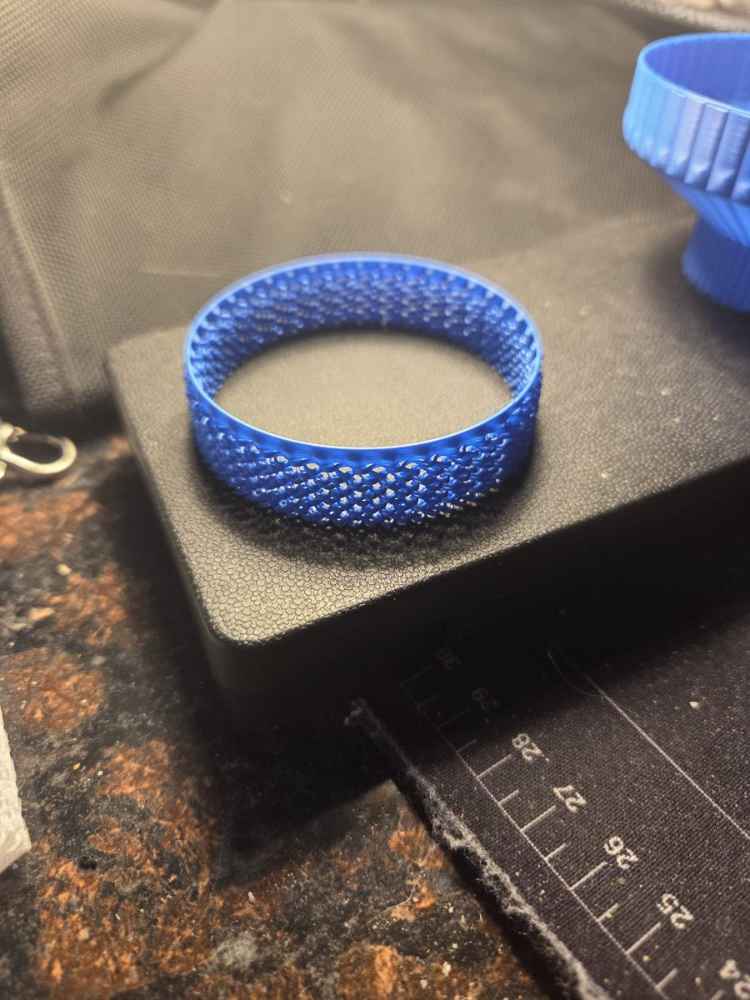 | 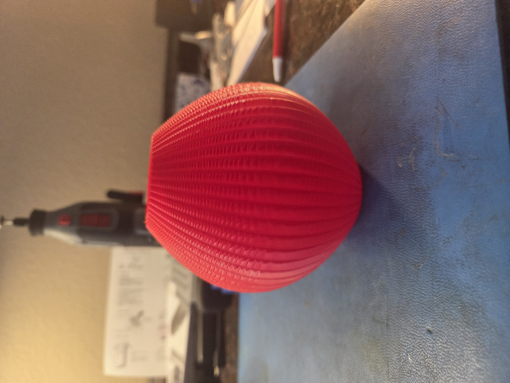 | 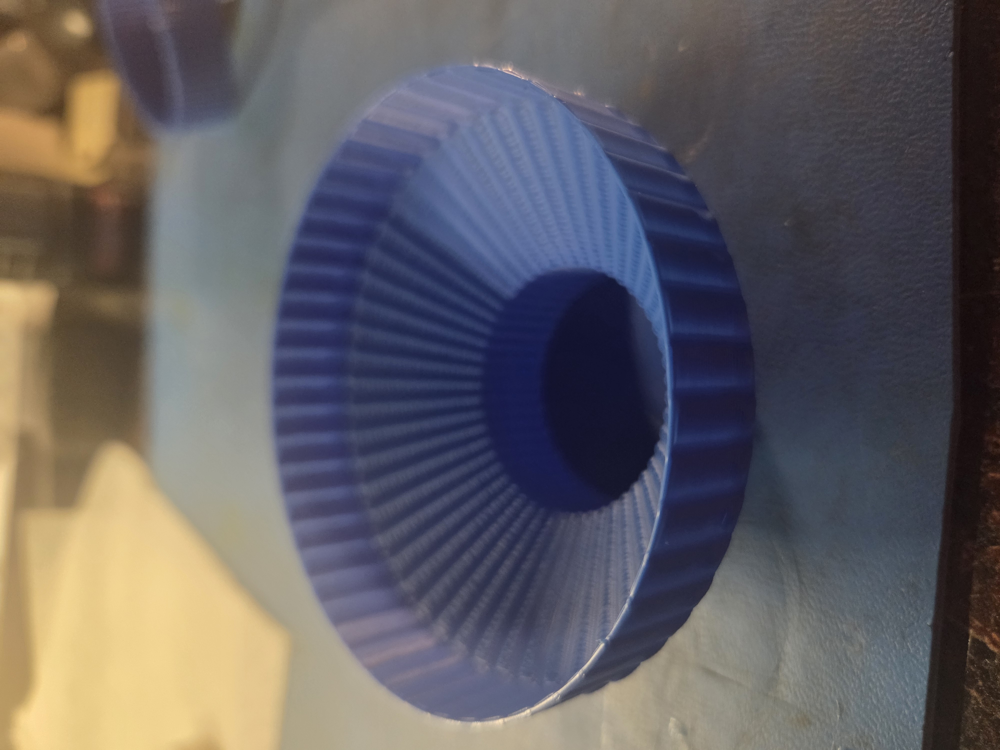 |
| Open weave, taller chain mail | Bulb Vase (Wave Script) | Test Flair (Wave Script) |

*Test prints on a Bambu Lab P2S in PLA, each with a solid rim on top.*

## Which script should I use?

| | **Wave Script** (`wave_script.py`) | **Weave Script** (`weave_script.py`) |
|---|---|---|
| How you choose the look | Set each value yourself: amplitude, wavelength, phase shift, gap, stagger... | Pick a pattern by name: lattice, chainmail, basket, scales, brick, twill, ribs... |
| Different looks at different heights | No, one look for the whole part | Yes, with `--zones` (for example solid base, lattice middle, solid cap) |
| Wave shapes | Sine | Sine, triangle, square and scallop |
| Steep walls (`--adaptive`) | Yes | No (it warns you instead) |
| Best for | Fine-tuning, experimenting, steep shapes | Getting a good-looking pattern quickly |

Start with **Weave Script** if you just want a nice pattern. Use **Wave Script** when you want to
adjust every detail or your shape has steep sections. Both read the same models, use the same
Bambu template and write the same kind of files, and they live in the same folder (Weave Script
uses Wave Script's code, so keep both files together). See the [Weave Script guide](docs/WEAVE_GUIDE.md).

Current versions: Wave Script 0.7.2, Weave Script 0.4.5.

**Never used a command line?** Start with [Command line basics](docs/COMMAND_LINE_BASICS.md).
It takes about five minutes, and then you can copy and paste the example commands.

**Printing on a Bambu Lab printer?** Make a template first: [Making a Bambu template](docs/BAMBU_TEMPLATE.md).

**New here?** The [full guide](docs/GUIDE.md) covers every example command, the Bambu Studio
workflow step by step, tuning, troubleshooting and the test-print log.

## How it works

```
CAD model (.stl)  ->  wave_script.py  ->  G-code  ->  printer
```

A normal slicer always tries to build solid, closed walls, so it can't make these prints.
Wave Script writes every move itself:

1. It slices your model into layers and traces the **outside outline** of each layer.
2. It pushes that outline in and out with a **sine wave**.
3. It shifts the wave by **half a wave on every layer**, so the strands cross each other and
   form the woven lattice.
4. It spirals upward continuously, like vase mode, so there's no seam.

Your model doesn't need to be hollow or thin. Draw a **solid** vase, cup or lamp shade and
Wave Script uses only its outside surface.

## Good shapes to try

| Works great | Avoid |
|---|---|
| Vases, cups, pen holders, planters, lamp shades | Flat tops / lids |
| Cylinders, boxes, cones, twisted shapes | Overhangs steeper than ~35° (up to ~55–60° with `--adaptive`) |
| One closed outline per layer | Several separate parts on the same layer (only the largest is printed) |
| | Holes through the wall (only the outside outline is used) |

## Install (Windows, one time)

1. Install Python 3.10 or newer from [python.org](https://www.python.org/downloads/).
   During setup, tick **"Add python.exe to PATH"**.
2. Open this folder in File Explorer, click the address bar, type `cmd` and press Enter.
3. Install the libraries:

   ```
   python -m pip install -r requirements.txt
   ```

## Quick test with the included cylinder

```
python wave_script.py examples/test_cylinder.stl
```

This creates `examples/test_cylinder_wave.gcode` plus `examples/test_cylinder_wave_preview.png`.
(`make_test_cylinder.py` can make a cylinder in other sizes.)

### What the scripts create

Each run writes two files next to your model (or wherever `-o` says):

| File | What it is |
|---|---|
| `<model>_wave.gcode.3mf` / `<model>_weave.gcode.3mf` | The print. With `--bambu-template` it's a Bambu `.gcode.3mf` you open in Bambu Studio; without it, a plain `.gcode` for other printers. |
| `<model>_wave_preview.png` / `<model>_weave_preview.png` | A picture of the toolpath so you can check the pattern **before** printing: the whole part, a close-up of the wall and, for Wave Script, a cut through the wall with every strand to scale. |

Always look at the preview first; it's much faster than a test print. Add `--no-preview` to skip
it, and `-o` to choose the output name (the preview follows it). Running the same command again
overwrites both files, so use `-o` to keep versions you want to compare.

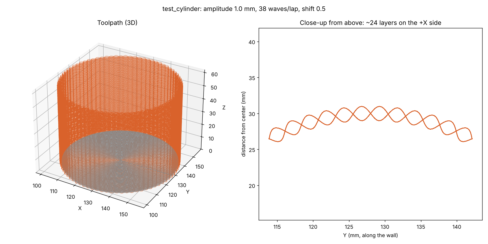

## Printing on a Bambu Lab printer (P2S, P1S, X1, A1...)

Bambu printers need their own start sequence (bed leveling, purge, AMS loading), so Wave Script
borrows it from a file that Bambu Studio sliced, called a *template*. The same template works
for Wave Script and Weave Script. **[Making a Bambu template](docs/BAMBU_TEMPLATE.md)** has the
full step-by-step guide, when to make a new one, and troubleshooting. In short:

1. In Bambu Studio, open the **same STL**, choose your printer, filament and plate, and click
   **Slice plate**. Leave the model where Bambu Studio puts it (plate center).
2. Choose **File > Export > Export plate sliced file** and save it, for example as
   `examples/template.gcode.3mf`.
3. Run:

   ```
   python wave_script.py examples/test_cylinder.stl --bambu-template examples/template.gcode.3mf
   ```

   (Save the template in the `examples` folder, or type the folder it's in.)

4. Open the new `examples/test_cylinder_wave.gcode.3mf` in Bambu Studio. It opens directly in preview,
   with nothing to re-slice. Click **Print plate**.

Temperatures, filament and bed leveling all come from the template, so re-export it if you
change filament.

## Other printers (Marlin / Klipper)

The plain `.gcode` output uses `profiles/generic_start.gcode` and `profiles/generic_end.gcode`.
**Check those two files for your printer before printing.** You can paste in your slicer's
start/end G-code and keep the `{nozzle_temp}` and `{bed_temp}` placeholders.

```
python wave_script.py my_vase.stl --nozzle-temp 210 --bed-temp 60 --bed-size 220 220
```

## Settings

Ranges are recommended starting points for a 0.4 mm nozzle, not hard limits. Change one
setting at a time and use `--max-height 10` for quick tests.

### Wave pattern

| Setting | Default | Range | What it does |
|---|---|---|---|
| `--amplitude` | 1.0 | 0.3 – 3.0 mm | How far the wall moves in and out of the CAD surface. Bigger = deeper texture and bigger openings, but more bridging. |
| `--wavelength` | 5.0 | 2 – 12 mm | Length of one wave. Rounded so a whole number of waves fits around the shape. |
| `--waves` | auto | 3 – 200 | Exact number of waves per lap. Overrides `--wavelength`. |
| `--phase-shift` | 0.5 | 0 – 0.5 | 0.5 = woven, crossing strands. 0 = straight vertical ribs (solid, always prints). 0.1–0.3 = diagonal twist. |
| `--weave-height` | 1 | 1 – 4 laps | Taller loops: this many laps stack on each side before the strands cross. 1 = classic weave. With `--stagger`, use a stagger that's a multiple of this (e.g. `--weave-height 2 --stagger 4`). |
| `--stagger` | 0 (off) | 0, 1 – 6 laps | Offsets every other row of loops by half a loop, giving a chain-mail / brick look. The number is how many laps make one row; 2 matches the classic look. |

### Open weave (see-through)

| Setting | Default | Range | What it does |
|---|---|---|---|
| `--weave-gap` | off | 0.1 – 0.5 mm | Open gap between strands. Can't be bigger than the strand. 0.2–0.3 is a safe start. |
| `--strand-diameter` | line width | 0.4 – 0.8 mm | Thickness of each strand in the open weave. Thicker = chunkier look, stronger, and allows bigger gaps. Above 0.6 mm, slow down (10–15 mm/s). |
| `--valley-depth` | 0 (off) | 0 – 3 mm | How deep the top edge dips between crossings, measured on a short test band printed with `--top-layers 0`. The rim then starts down in each dip and levels the top, so it bonds instead of lifting. See "Open weaves: the top rim" below. |
| `--valley-slope` | 1.3 | 1.0 – 1.4 | Steepest dip into a valley (rise over run). 1.0 = 45°, 1.3 = about 52°. Lower it if the nozzle touches the peaks. |
| `--densify-height` | 2 | 0 – 6 mm | Height under the rim where the open gaps close into a dense band (used when `--valley-depth` is off). |

### Printing

| Setting | Default | Range | What it does |
|---|---|---|---|
| `--layer-height` | 0.2 | 0.1 – 0.3 mm | Height of each layer (solid mode and the base). With `--weave-gap` the wall sets its own rise. |
| `--line-width` | 0.5 | 0.4 – 0.7 mm | Width of each line. Wider lines bridge gaps more easily. |
| `--flow` | 1.0 | 0.9 – 1.1 | Extrusion multiplier. Raise it a little if strands look thin or break. |
| `--speed` | 25 | 10 – 40 mm/s | Wall speed. Slower is better for bridged strands. Use 12–18 for open weaves. |
| `--first-layer-speed` | 15 | 10 – 30 mm/s | Speed of the first layer touching the bed. |
| `--base-speed` | 30 | 20 – 60 mm/s | Speed of the solid bottom. |
| `--adaptive` | off | on / off | Measures the wall angle as it prints and uses thinner layers and slower speed on steep sections. Lets solid weaves go to about 55–60°. |
| `--max-overhang` | 0.15 | 0.10 – 0.25 mm | With `--adaptive`: how far one lap may stick out past the one below. Lower = safer and slower. |
| `--min-layer-height` | 0.08 | 0.06 – 0.15 mm | With `--adaptive`: the thinnest layer it may use. |
| `--top-layers` | 2 | 0 – 4 | Solid rim laps on top, so the weave can't unravel at the top edge. 0 = no rim. |
| `--base-layers` | 3 | 0 – 6 | Solid bottom layers. 0 = open bottom (lamp shades, sleeves). |
| `--fan-layer` | 2 | 1 – 5 | Layer where the part cooling fan turns on (full speed). |
| `--point-spacing` | 0.3 | 0.1 – 0.5 mm | Distance between points along the path. Smaller = smoother waves and bigger files. Keep it under 1/10 of the wavelength. |
| `--filament-diameter` | 1.75 | 1.75 or 2.85 mm | Your filament size. |
| `--nozzle-temp` | 215 | 190 – 260 °C | Generic printers only. Bambu uses the template's temperature. |
| `--bed-temp` | 60 | 0 – 110 °C | Generic printers only. Bambu uses the template's temperature. |
| `--max-height` | full | 5 mm – model height | Stop printing at this height. Great for quick tests. |

### Printer and output

| Setting | Default | What it does |
|---|---|---|
| `--bambu-template` | none | A `.gcode.3mf` sliced in Bambu Studio for your printer. Output becomes a `.gcode.3mf`. |
| `--bed-size X Y` | 256 256 | Bed size in mm (P2S/P1S/X1 = 256 256, A1 mini = 180 180). |
| `--flip` | off | Print the model upside down. Rotating or flipping the part in Bambu Studio does **not** carry over, because Wave Script reads the STL directly. |
| `--center X Y` | bed center | Where to place the model. Keep it matching where Bambu Studio placed the template. |
| `--seam-angle` | 0 | Where each lap starts, in degrees: 0 = right, 90 = back, 180 = left, 270 = front. |
| `--start-gcode` / `--end-gcode` | `profiles/` files | Start/end G-code for generic printers. |
| `-o`, `--output` | `<model>_wave.gcode` | Output file name. |
| `--no-preview` | off | Skip the preview image. |

Run `python wave_script.py --help` for the full list.

## What the settings look like

Each picture shows three values of one setting on the same cylinder. The top row is the
outside of the wall, unrolled flat (lighter = closer to you). The bottom row is a cut through
the wall with every strand drawn to scale, so you can see how the strands stack and where the
gaps are. The pictures are made by `docs/make_doc_images.py`; you only need it if you change
the code and want to redraw them (see "Documentation image scripts" in the [full guide](docs/GUIDE.md)).

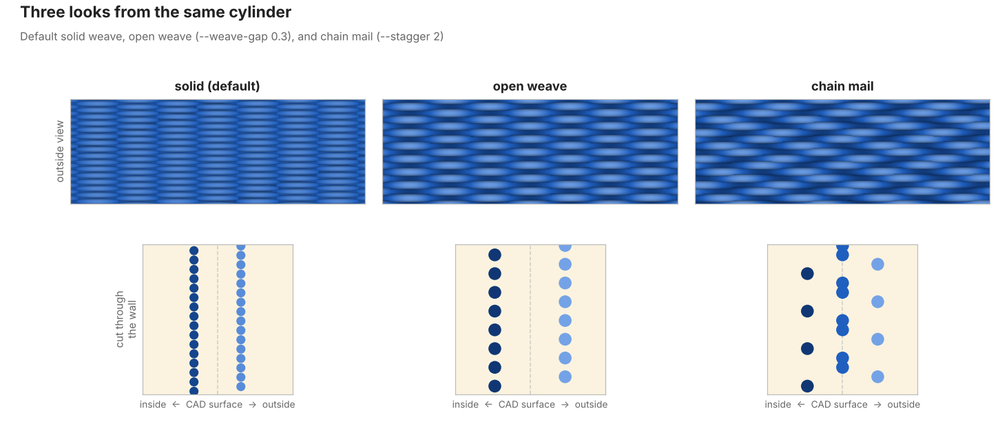

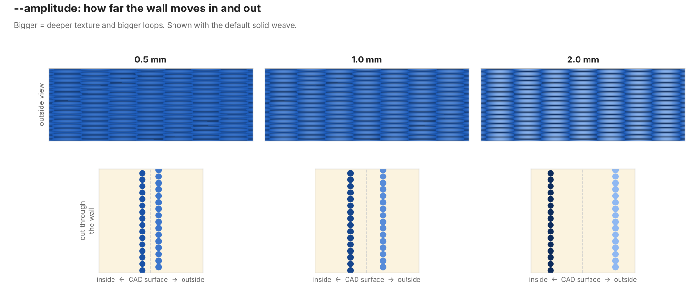

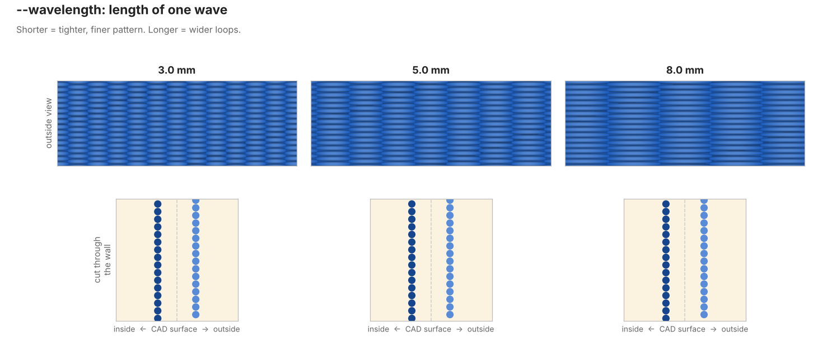

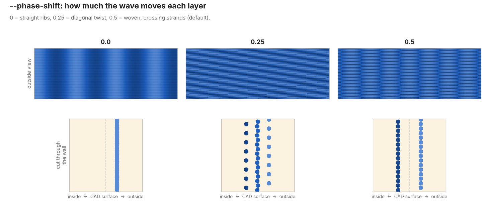

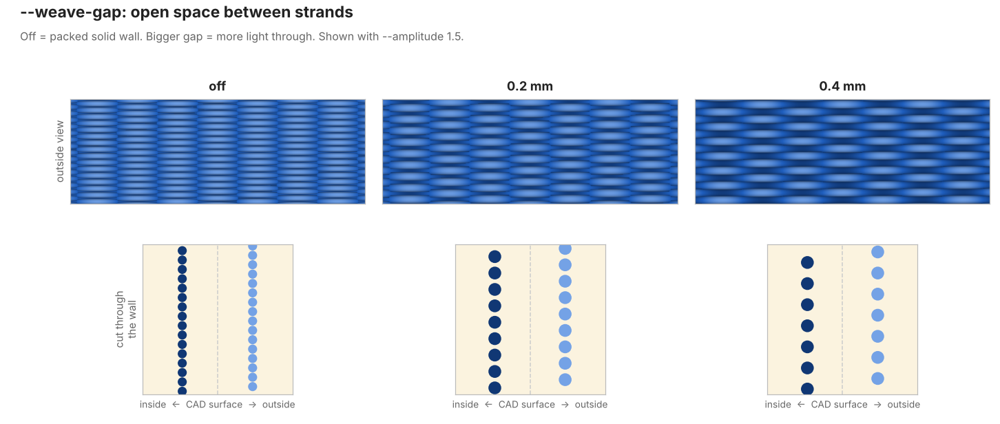

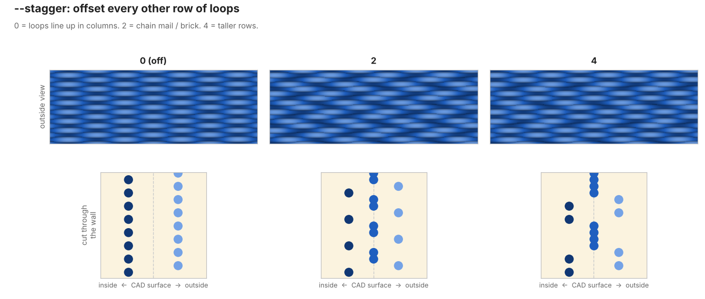

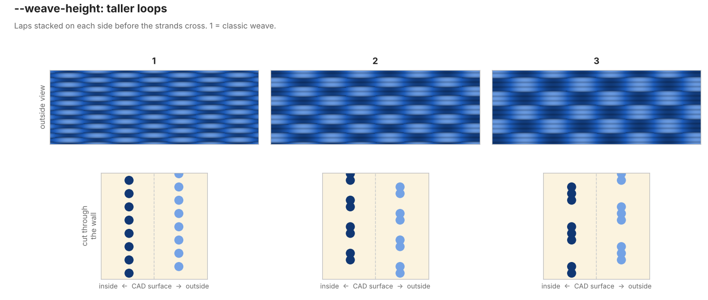

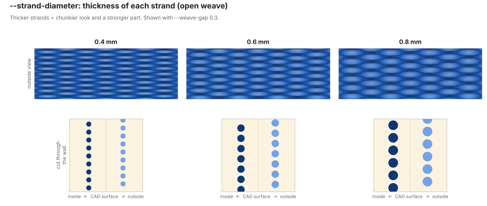

### Open weave (lamp shades)

By default the strands are packed tight, giving a solid textured wall. For a lamp shade that
lets light through, open up the weave and leave the bottom off:

```
python wave_script.py my_shade.stl --base-layers 0 --weave-gap 0.3 --amplitude 1.5 --speed 15
```

How it works: every other layer is on the same side of the wave. `--weave-gap` raises each lap
so those strands sit with an open gap between them. The strands only touch where they cross,
and light shows through the diamonds in between. The right-hand panel of the preview image is
a to-scale cut through the wall, so you can see the gaps before you print.

- The gap can't be bigger than the strand (the layers would stop touching).
- Bigger `--amplitude` and `--wavelength` make bigger openings.
- Print slower (12–18 mm/s) with the fan on, since most of each strand is bridging.

For the chain-mail look, where each row of loops sits between the loops below it, add
`--stagger 2`:

```
python wave_script.py my_shade.stl --base-layers 0 --weave-gap 0.3 --amplitude 1.5 --stagger 2 --speed 15
```

The bottom-left panel of the preview image shows the wall unrolled flat, so you can compare
the pattern with and without stagger before printing.

For taller loops, stack several laps on each side before the strands cross:

```
python wave_script.py my_shade.stl --base-layers 0 --weave-gap 0.3 --amplitude 1.5 --weave-height 2 --stagger 4 --speed 15
```

### Open weaves: the top rim

Every print finishes with 2 solid rim laps (`--top-layers`) so the top edge can't unravel.
On open weaves that's harder than it sounds: the strands sag between crossings, so the top
edge is a row of peaks and valleys, and a flat rim only touches the peaks, then peels off as it
cools. The fix that held in testing:

1. Print a short band with no rim: add `--top-layers 0 --max-height 15`.
2. Measure how deep the top edge dips from a peak to the valley next to it.
3. Print with `--valley-depth` set to that number. The rim starts down in each valley and
   levels the top before the flat rim laps.

```
python wave_script.py my_shade.stl --base-layers 0 --weave-gap 0.3 --amplitude 1.5 --weave-height 2 --stagger 4 --speed 12 --valley-depth 1.0
```

Weave Script's lattice and chainmail patterns already know their measured dips (2.25 mm and
0.9 mm). The [full guide](docs/GUIDE.md) has the whole story in its test log.

### Steep walls (adaptive layers)

On a sloped wall, each lap sits a little further out than the one below it:
**overhang per lap = layer height × tan(angle)**. Thinner layers keep that overhang small.
`--adaptive` measures the wall angle at every lap and does this for you:

```
python wave_script.py my_vase.stl --adaptive
```

To try it, use the included flared test vase, `examples/test_flare.stl` (55° flare). Make its
own Bambu template first.

- Straight sections print at your normal layer height and speed.
- Steep sections get thinner layers, down to `--min-layer-height`, and slow down to as low as 60%.
- It looks ahead, so it thins out before the slope starts, and grows back gently afterward.
- If a section is still too steep, the script tells you the height and angle.

Even without `--adaptive`, the script warns you about steep sections.
Open weaves (`--weave-gap`) can't change layer height, because the gap sets it. For those,
`--adaptive` only slows down, so keep open-weave slopes around 30–35°.

### Tuning tips

- Start with a short test: `--max-height 10`.
- If strands sag or break: lower `--speed`, raise `--line-width`, or lower `--amplitude`.
- If the pattern is too subtle: raise `--amplitude` or `--wavelength`.
- `--phase-shift 0` always prints reliably (no bridging), so it's a good first print.

## Weave Script: patterns by name

Wave Script gives you every setting. If you just want a look, `weave_script.py` (in the same
folder) has ready-made patterns: **lattice** (open, deep pleats), **chainmail** (open rings),
**diamond**, **basket**, **twill**, **scales**, **brick**, **ribs** and the experimental
**diamonds** (big diagonal diamonds). It can also mix them in height
**zones**, for example a solid base, a lattice middle and a solid cap:

```
python weave_script.py --list
python weave_script.py examples/bulb_vase.stl --pattern lattice
python weave_script.py examples/bulb_vase.stl --zones "0-12:solid, 12-60%:lattice, 60%-:solid"
```

See the [Weave Script guide](docs/WEAVE_GUIDE.md).

## Known issues

- **Tall open weaves on the Bambu P2S:** above about 20 mm, open patterns can print messy loops
  on the front of the part while the back stays clean. It looks printer-side (most likely
  uneven cooling), and a fix is being investigated. Short bands print cleanly.
- **`diamonds` is experimental:** loops can deform on one side of the part.
- **Tested on a Bambu Lab P2S only so far.** Other printers should work with the plain
  `.gcode` output, but expect to tune speed and cooling.

Found a problem? Open an issue with your command, a photo and the preview image.

## Credits

Created by **Joe Pitz, Objetek Systems**.


Inspired by [FullControl](https://fullcontrol.xyz) by Andrew Gleadall. Slicing uses
[trimesh](https://trimesh.org) and [shapely](https://shapely.readthedocs.io).

## License

MIT. See [LICENSE](LICENSE).
