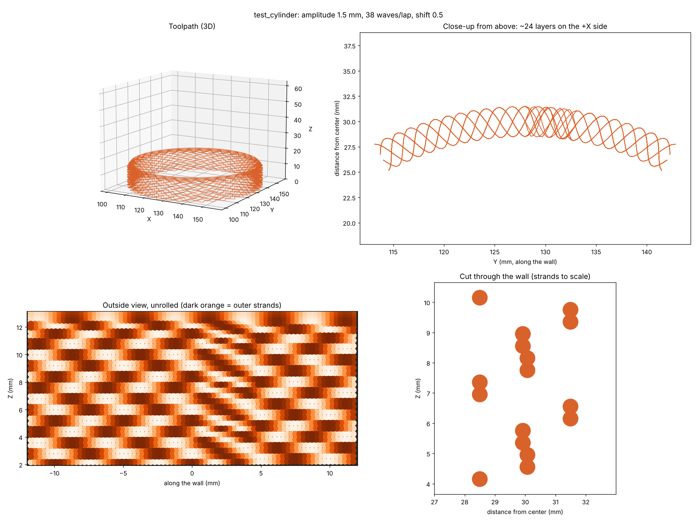

# Wave Script: Guide and Reference

This guide collects everything about Wave Script in one place: what it is, how to set it up,
how to print on a Bambu Lab printer, every example command, tuning tips, troubleshooting,
and the test-print history. The [README](../README.md) has the short version and the
settings tables.

---

## 1. Background: why this tool exists

The wavy, woven-strand prints made famous by [FullControl](https://fullcontrol.xyz) can't be
made with a normal slicer. A slicer always tries to build solid, closed walls. These prints
need lines that bridge, cross and leave gaps on purpose.

Here's how the existing options compare:

| Option | Takes your CAD model? | Notes |
|---|---|---|
| FullControl (website / Python library) | No | Each design is a small program that calculates every nozzle move from math. The models on the website print small because their size parameters default to small values. Change the parameters and they print full size. |
| Grasshopper (Rhino) | Yes | Can slice a mesh and add waves, but needs a paid Rhino license. |
| Slicer fuzzy skin (Bambu Studio / Orca) | Yes | Random surface texture only, not clean, flowing strands. |
| **Wave Script** | **Yes** | Free Python tool: STL in, wavy G-code out. No Rhino, no slicer. |

Wave Script lets an average user draw a simple shape in **Shapr3D, Tinkercad, Fusion 360 or
any CAD app** and turn it into a FullControl-style print.

---

## 2. How it works

```
CAD model (.stl / .3mf / .obj)  ->  wave_script.py  ->  G-code  ->  printer
```

1. **Slice.** The [trimesh](https://trimesh.org) library cuts the model into layers. Trimesh
   is a library the script uses internally, not a separate step.
2. **Trace.** For each layer, the script takes the **outside outline** of the model.
3. **Wave.** The outline is pushed in and out with a sine wave.
4. **Weave.** The wave shifts half a wave every layer, so the strands cross each other and
   form the woven look.
5. **Spiral.** The nozzle rises continuously, like vase mode, so there's no seam.
6. **Write.** The script calculates extrusion for every move and writes the finished G-code.
   For Bambu printers it packages it as a `.gcode.3mf`.

The script **replaces the slicer**. It does not edit slicer output.

**How this differs from a non-planar post-processor:**

- **Post-processor:** CAD → slicer → slicer's G-code → post-processor edits it → print.
  The slicer does the main work.
- **Wave Script:** CAD → wave script → print. The script builds every move itself, which is
  why it can make strands a slicer won't.

**Your model doesn't need to be thin or hollow.** Draw a solid vase, cup or lamp shade.
Wave Script only uses its outside surface.

### Wave Script or Weave Script?

| | **Wave Script** (`wave_script.py`) | **Weave Script** (`weave_script.py`) |
|---|---|---|
| How you choose the look | Set each value yourself: amplitude, wavelength, phase shift, gap, stagger... | Pick a pattern by name: lattice, chainmail, basket, scales, brick, twill, ribs... |
| Different looks at different heights | No, one look for the whole part | Yes, with `--zones` (for example solid base, lattice middle, solid cap) |
| Wave shapes | Sine | Sine, triangle, square and scallop |
| Steep walls (`--adaptive`) | Yes | No (it warns you instead) |
| Best for | Fine-tuning, experimenting, steep shapes | Getting a good-looking pattern quickly |

Start with **Weave Script** if you just want a nice pattern. Use **Wave Script** when you want to
adjust every detail or your shape has steep sections. Both read the same models, use the same
Bambu template and write the same kind of files, and they live in the same folder (Weave Script
uses Wave Script's code, so keep both files together).

The [Weave Script guide](WEAVE_GUIDE.md) covers its patterns and zones. This guide covers Wave
Script, and everything about templates, printing and the rim applies to both.

### What the scripts create

Each run writes two files next to your model (or wherever `-o` says):

| File | What it is |
|---|---|
| `<model>_wave.gcode.3mf` / `<model>_weave.gcode.3mf` | The print. With `--bambu-template` it's a Bambu `.gcode.3mf` you open in Bambu Studio; without it, a plain `.gcode` for other printers. |
| `<model>_wave_preview.png` / `<model>_weave_preview.png` | A picture of the toolpath so you can check the pattern **before** printing: the whole part, a close-up of the wall and, for Wave Script, a cut through the wall with every strand to scale. |

Always look at the preview first; it's much faster than a test print. Add `--no-preview` to skip
it, and `-o` to choose the output name (the preview follows it). Running the same command again
overwrites both files, so use `-o` to keep versions you want to compare.

---

## 3. Installing (Windows)

1. Install **Python 3.10 or newer** from [python.org](https://www.python.org/downloads/).
   During setup, tick **"Add python.exe to PATH"**.
2. Open the Wave Script folder in File Explorer, click the address bar, type `cmd` and press
   **Enter**. A command prompt opens in that folder.
3. Install the libraries (trimesh, numpy, shapely, networkx, scipy, lxml and matplotlib):

   ```
   python -m pip install -r requirements.txt
   ```

   Use `python -m pip`, not plain `pip`, so the libraries install into the same Python that
   runs the script.

4. Check that it works:

   ```
   python wave_script.py --version
   ```

**Optional: build123d for the model-making scripts.** `examples/make_bulb_vase.py` and
`examples/make_torture_tower.py` build their models with the build123d CAD library. It's
large and can upgrade shared libraries such as Pillow, which can break other tools like Gradio,
so install it in a separate **virtual environment**:

```
python -m venv cadenv
cadenv\Scripts\activate
python -m pip install build123d
```

Run `cadenv\Scripts\activate` before using those scripts, and `deactivate` when you're done.
You only need this to *rebuild* the example models. The STL files are already included.

---

## 4. First test (any printer)

Run the included 60 × 60 mm test cylinder:

```
python wave_script.py examples/test_cylinder.stl
```

This writes `examples/test_cylinder_wave.gcode` plus `examples/test_cylinder_wave_preview.png`.
Always look at the preview before printing.

### Reading the preview image

Here's the preview for the open-weave band from test 15 (the first top rim that held):

```
python wave_script.py examples/test_cylinder.stl --base-layers 0 --weave-gap 0.3 --amplitude 1.5 --weave-height 2 --stagger 4 --speed 12 --max-height 15
```



The Weave Script guide has previews for the lattice, chainmail and diamonds patterns.

| Panel | What it shows |
|---|---|
| Top left: Toolpath (3D) | The whole print. |
| Top right: Close-up from above | About 24 layers of wall. Crossing lines = woven strands. |
| Bottom left: Outside view, unrolled | The wall flattened out. Use it to check the loop pattern (columns vs. chain mail). |
| Bottom right: Cut through the wall | Every strand drawn to scale. Gaps between circles = see-through openings. |

---

## 5. Printing on a Bambu Lab printer (P2S, P1S, X1, A1)

Bambu printers need their own start sequence: bed leveling, purge line and AMS loading.
Wave Script borrows it from a file that Bambu Studio sliced.

### Model file types

Wave Script reads **STL** (most reliable), **3MF** and **OBJ** models. A 3MF exported from
Shapr3D or Fusion works. A Bambu Studio *project* 3MF may hold several plates and parts, so
export a plain STL or 3MF from your CAD app for best results. Don't confuse your model with the
`.gcode.3mf` template, which is the sliced file from Bambu Studio.

### Step 1: make a template

The full guide, with when to make a new template and troubleshooting, is in
[Making a Bambu template](BAMBU_TEMPLATE.md). The short version:

1. In Bambu Studio, open the **same STL** you're going to wave.
2. Pick your printer, plate and **the filament you'll print with**. Put the matching spool in
   slot 1 so the right color shows up later.
3. Leave the model where Bambu Studio puts it (plate center). Click **Slice plate**.
4. Choose **File → Export → Export plate sliced file** and save it, for example as
   `examples/template.gcode.3mf`.

### Step 2: run the script with the template

```
python wave_script.py examples/test_cylinder.stl --bambu-template examples/template.gcode.3mf
```

> **Watch the folder path.** If the template is in `examples`, type `examples/template.gcode.3mf`.
> Typing only `template.gcode.3mf` gives `Template not found`.

### Step 3: print

1. Open the new `examples/test_cylinder_wave.gcode.3mf` in Bambu Studio. It opens straight
   into the **Preview** tab, already sliced.
2. **Don't change anything in the Prepare tab.** Changing the filament there makes Bambu Studio
   try to re-slice. It can't re-slice custom G-code, so the model disappears.
3. Click **Print plate**. In the send window, click the filament box and map **Filament 1** to
   the AMS slot or external spool you want. This is where you pick the spool. Nothing in the
   G-code needs to change.

### Things to know

- **Temperatures and bed leveling come from the template.** If you change material (PLA →
  PETG, for example), re-slice and re-export the template with the new filament, then run the
  script again. Changing color within the same material only needs the mapping step.
- **One template per model.** Bed leveling covers the area of the model in the template, so
  slice the same STL you're waving.
- The output is marked as a spiral (vase-mode) print so Bambu Studio's preview loads quickly.
  Without that mark, the preview counted every tiny Z step as a new layer and took a very long
  time to load.

---

## 6. Printing on other printers (Marlin / Klipper)

The plain `.gcode` output uses `profiles/generic_start.gcode` and `profiles/generic_end.gcode`.
**Check both files for your printer before printing.** You can paste in your slicer's start
and end G-code. Keep the `{nozzle_temp}` and `{bed_temp}` placeholders.

```
python wave_script.py my_vase.stl --nozzle-temp 210 --bed-temp 60 --bed-size 220 220
```

---

## 7. Designing models for Wave Script

| Works great | Avoid |
|---|---|
| Vases, cups, pen holders, planters, lamp shades, sleeves | Flat tops / lids (only the walls print) |
| Cylinders, boxes, cones, revolves, twisted shapes | Overhangs steeper than about 35° (about 55–60° with `--adaptive`, solid weave only) |
| One closed outline per layer | Several separate parts on the same layer (only the largest prints) |
| Solid models (only the outside is used) | Holes through the wall (only the outside outline is used) |

**Shapr3D revolve tips:**

- Sketch the profile as a **closed shape that touches the center axis**, so the revolve comes
  out solid.
- Keep the sides gentle, at most about 35° from vertical. Bulges are fine; steep shoulders sag.
  For steeper shapes, use `--adaptive` (see section 9).
- Export the STL at **high resolution** so the waves stay smooth. Coarse facets show up as flat
  spots.
- Slice that same STL in Bambu Studio for its template.

**Shapes that change width a lot (bulbs, flares, necks):**

- The number of waves per lap is set once, from the bottom of the model. Where the shape gets
  wider, the waves stretch out; where it narrows, they bunch up. On the bulb vase this looks
  good, but set `--waves` yourself if you want an even pattern around the widest part.

**Designing models in code (build123d):**

- Claude can build models in Python with build123d and export **STEP** (opens as an editable
  solid in Shapr3D or Fusion) plus **STL** (for Wave Script). The bulb vase and torture tower
  were made this way. See `examples/make_bulb_vase.py` and `examples/make_torture_tower.py`.
- Keep a few millimetres of straight wall at the bottom before a curve starts, so the first
  laps have a solid start. `make_bulb_vase.py` does this with `--straight 3`.

---

## 8. Example commands

Every example uses the test cylinder and the Bambu template. For your own model, replace
`examples/test_cylinder.stl` with your STL. For non-Bambu printers, leave off
`--bambu-template ...`.

> Add `--max-height 10` (or 20) to any command for a quick test print of just the bottom
> section.

### Basic looks

**Default woven texture (solid wall):**
```
python wave_script.py examples/test_cylinder.stl --bambu-template examples/template.gcode.3mf
```

**Quick 10 mm test print:**
```
python wave_script.py examples/test_cylinder.stl --bambu-template examples/template.gcode.3mf --max-height 10
```

**Straight vertical ribs (always prints, no bridging):**
```
python wave_script.py examples/test_cylinder.stl --bambu-template examples/template.gcode.3mf --phase-shift 0
```

**Diagonal twist:**
```
python wave_script.py examples/test_cylinder.stl --bambu-template examples/template.gcode.3mf --phase-shift 0.25
```

**Deeper, more dramatic texture:**
```
python wave_script.py examples/test_cylinder.stl --bambu-template examples/template.gcode.3mf --amplitude 1.5 --wavelength 7
```

**Fine, tight texture:**
```
python wave_script.py examples/test_cylinder.stl --bambu-template examples/template.gcode.3mf --amplitude 0.6 --wavelength 3
```

**Exact number of waves around the shape (40):**
```
python wave_script.py examples/test_cylinder.stl --bambu-template examples/template.gcode.3mf --waves 40
```

### Open weave and lamp shades

**Open, see-through weave with no bottom:**
```
python wave_script.py examples/test_cylinder.stl --bambu-template examples/template.gcode.3mf --base-layers 0 --weave-gap 0.3 --amplitude 1.5 --speed 15
```

**Open weave, 20 mm test band:**
```
python wave_script.py examples/test_cylinder.stl --bambu-template examples/template.gcode.3mf --base-layers 0 --weave-gap 0.3 --amplitude 1.5 --speed 15 --max-height 20
```

**Chain mail (rows of loops offset like bricks):**
```
python wave_script.py examples/test_cylinder.stl --bambu-template examples/template.gcode.3mf --base-layers 0 --weave-gap 0.3 --amplitude 1.5 --stagger 2 --speed 15
```

**Chain mail with taller rows:**
```
python wave_script.py examples/test_cylinder.stl --bambu-template examples/template.gcode.3mf --base-layers 0 --weave-gap 0.3 --amplitude 1.5 --stagger 4 --speed 15
```

**Chunky, thick strands (like the "thick extrusion lines" look):**
```
python wave_script.py examples/test_cylinder.stl --bambu-template examples/template.gcode.3mf --base-layers 0 --strand-diameter 0.7 --weave-gap 0.4 --amplitude 1.5 --stagger 2 --speed 12
```

**Bigger windows for more light:**
```
python wave_script.py examples/test_cylinder.stl --bambu-template examples/template.gcode.3mf --base-layers 0 --weave-gap 0.4 --amplitude 2 --wavelength 7 --speed 15
```

**Taller loops (3 laps per side):**
```
python wave_script.py examples/test_cylinder.stl --bambu-template examples/template.gcode.3mf --base-layers 0 --weave-gap 0.3 --amplitude 1.5 --weave-height 3 --speed 15
```

**Taller chain mail (2 laps per side, rows of 4 laps):**
```
python wave_script.py examples/test_cylinder.stl --bambu-template examples/template.gcode.3mf --base-layers 0 --weave-gap 0.3 --amplitude 1.5 --weave-height 2 --stagger 4 --speed 15
```

**Thicker top rim (4 solid laps):**
```
python wave_script.py examples/test_cylinder.stl --bambu-template examples/template.gcode.3mf --base-layers 0 --weave-gap 0.3 --amplitude 1.5 --stagger 2 --top-layers 4 --speed 15
```

**No top rim (open top edge):**
```
python wave_script.py examples/test_cylinder.stl --bambu-template examples/template.gcode.3mf --top-layers 0
```

### Steep shapes

These use `examples/test_flare.stl`, a vase that flares out at 55° through its middle third.
Slice **that** STL in Bambu Studio and export it as `examples/template_flare.gcode.3mf` first.
(The cylinder has no slope, so `--adaptive` wouldn't change anything on it.)

**See the steep-section warning (no adaptive):**
```
python wave_script.py examples/test_flare.stl --bambu-template examples/template_flare.gcode.3mf
```

**Automatic thinner layers on steep sections:**
```
python wave_script.py examples/test_flare.stl --bambu-template examples/template_flare.gcode.3mf --adaptive
```

**Extra-safe for very steep flares (smaller overhang, thinner minimum layer):**
```
python wave_script.py examples/test_flare.stl --bambu-template examples/template_flare.gcode.3mf --adaptive --max-overhang 0.12 --min-layer-height 0.06
```

**Faster adaptive (allows more overhang):**
```
python wave_script.py examples/test_flare.stl --bambu-template examples/template_flare.gcode.3mf --adaptive --max-overhang 0.2
```

**Print the flare upside down (wide end on the bed):**
```
python wave_script.py examples/test_flare.stl --bambu-template examples/template_flare.gcode.3mf --flip --adaptive
```

### Bulb vase

`examples/bulb_vase.stl` is a 90 × 90 × 90 mm bulb that leans out at the bottom and in at the
top, up to about 49°. Slice it in Bambu Studio and export the template as
`examples/template_bulb.gcode.3mf` first.

**Bulb vase (test 6):**
```
python wave_script.py examples/bulb_vase.stl --bambu-template examples/template_bulb.gcode.3mf --adaptive
```

**Bulb vase with a tighter pattern around the belly:**
```
python wave_script.py examples/bulb_vase.stl --bambu-template examples/template_bulb.gcode.3mf --adaptive --waves 40
```

**Rebuild the bulb in another size (needs build123d, see section 3):**
```
python examples/make_bulb_vase.py --height 120 --max-diameter 110 --opening 45
```

`make_bulb_vase.py` options: `--height`, `--max-diameter`, `--base`, `--opening`, `--bulge-at`
(0 = bottom, 1 = top) and `--straight` (straight foot height). It writes `bulb_vase.step` and
`bulb_vase.stl` next to the script.

### Torture tower (algorithm stress test)

`examples/torture_tower.stl` is a 70 × 70 × 90 mm test part that combines every hard case in
one print:

| Height (mm) | Zone | What it tests |
|---|---|---|
| 0–12 | Straight 50 mm circle | Baseline texture |
| 12–24 | Gentle 30° flare out | `--adaptive` should barely react |
| 24–38 | Circle morphing into a twisting rounded square | Corners and a changing outline |
| 38–52 | 6-lobe flower | Concave dips and tight curves |
| 52–62 | Steep neck in (about 60°) | Inward overhang |
| 62–74 | Thin 26 mm neck | Small perimeter, tightly packed waves |
| 74–84 | Steep flare out (about 50°) | Outward overhang |
| 84–90 | Straight lip | Where the top rim lands |

The zone boundaries are sharp kinks on purpose, to test the look-ahead and the speed and
layer ramps. With `--adaptive`, expect one warning at **Z ≈ 38 mm (66°)**, where the square's
corners pull in sharply to the flower. That's the spot to watch.

Slice `examples/torture_tower.stl` in Bambu Studio and export the template as
`examples/template_tower.gcode.3mf`, then run:

**Torture tower:**
```
python wave_script.py examples/torture_tower.stl --bambu-template examples/template_tower.gcode.3mf --adaptive
```

**Torture tower, base up to the start of the upper taper (quick check of the morph and flower zones):**
```
python wave_script.py examples/torture_tower.stl --bambu-template examples/template_tower.gcode.3mf --adaptive --max-height 52
```

**Torture tower, open weave (much harder):**
```
python wave_script.py examples/torture_tower.stl --bambu-template examples/template_tower.gcode.3mf --adaptive --weave-gap 0.2 --speed 15
```

`examples/make_torture_tower.py` rebuilds the tower, for example
`python examples/make_torture_tower.py --scale 0.8` for a smaller, faster test. It needs the
build123d CAD library (`python -m pip install build123d`), which isn't part of
`requirements.txt`. Install it in a virtual environment so it doesn't clash with other tools.

### Rim test prints (tests 10–17)

These are the commands from the open-weave rim tests in the test log (section 12), as they
run with the current scripts. Older tests were made with earlier versions, so the same command
now gives the improved result. Each one writes its own file with `-o` so it doesn't overwrite
the others.

**Wave Script open weave with taller chain mail, 15 mm band (test 15, the first rim that held):**
```
python wave_script.py examples/test_cylinder.stl --bambu-template examples/template.gcode.3mf --base-layers 0 --weave-gap 0.3 --amplitude 1.5 --weave-height 2 --stagger 4 --speed 12 --max-height 15
```

**The same band with no rim, to measure the dips at the top edge:**
```
python wave_script.py examples/test_cylinder.stl --bambu-template examples/template.gcode.3mf --base-layers 0 --weave-gap 0.3 --amplitude 1.5 --weave-height 2 --stagger 4 --speed 12 --max-height 15 --top-layers 0 -o examples/test_cylinder_wave_norim.gcode.3mf
```

**The same band with valley fill** (replace 1.0 with the dip you measured):
```
python wave_script.py examples/test_cylinder.stl --bambu-template examples/template.gcode.3mf --base-layers 0 --weave-gap 0.3 --amplitude 1.5 --weave-height 2 --stagger 4 --speed 12 --max-height 15 --valley-depth 1.0 -o examples/test_cylinder_wave_valley.gcode.3mf
```

**Wave Script classic chain mail that crosses on every lap (`--stagger 2`), 15 mm band:**
```
python wave_script.py examples/test_cylinder.stl --bambu-template examples/template.gcode.3mf --base-layers 0 --weave-gap 0.3 --amplitude 1.5 --stagger 2 --speed 15 --max-height 15 -o examples/test_cylinder_wave_chainmail.gcode.3mf
```

**Weave Script chainmail, 15 mm band (tests 15w, 15w2):**
```
python weave_script.py examples/test_cylinder.stl --bambu-template examples/template.gcode.3mf --pattern chainmail --base-layers 0 --max-height 15
```

**Weave Script control: chainmail set up like test 15 (test 15c):**
```
python weave_script.py examples/test_cylinder.stl --bambu-template examples/template.gcode.3mf --zones "0-:chainmail@group=2,stagger=4,cell=2.5" --speed 12 --top-layers 2 --node-flow 1.0 --valley-depth 0 --base-layers 0 --max-height 15 -o examples/test_cylinder_weave_control.gcode.3mf
```

**Weave Script chainmail with no rim, to measure its dips (test 16):**
```
python weave_script.py examples/test_cylinder.stl --bambu-template examples/template.gcode.3mf --pattern chainmail --top-layers 0 --base-layers 0 --max-height 15 -o examples/test_cylinder_chainmail_norim.gcode.3mf
```

**Weave Script lattice, 20 mm band (test 15L5, clean rim; the preset since 0.3.2):**
```
python weave_script.py examples/test_cylinder.stl --bambu-template examples/template.gcode.3mf --pattern lattice --base-layers 0 --max-height 20 -o examples/test_cylinder_lattice.gcode.3mf
```

**Lattice with no rim, to measure the dips (test 15L3, measured 2.25 mm):**
```
python weave_script.py examples/test_cylinder.stl --bambu-template examples/template.gcode.3mf --pattern lattice --top-layers 0 --base-layers 0 --max-height 20 -o examples/test_cylinder_lattice_norim.gcode.3mf
```

**Lattice with gentler dips into the valleys** (if the nozzle touches the peaks; test 15L4 used 45°):
```
python weave_script.py examples/test_cylinder.stl --bambu-template examples/template.gcode.3mf --pattern lattice --valley-slope 1.0 --base-layers 0 --max-height 20 -o examples/test_cylinder_lattice_gentle.gcode.3mf
```

**The original lattice preset settings (test 15L, the weave collapsed; for comparison only):**
```
python weave_script.py examples/test_cylinder.stl --bambu-template examples/template.gcode.3mf --pattern lattice --depth 2.5 --gap 0.45 --speed 18 --valley-depth 0 --base-layers 0 --max-height 20 -o examples/test_cylinder_lattice_old.gcode.3mf
```

**Big diamonds, soft (test 17, experimental), 40 mm band:**
```
python weave_script.py examples/test_cylinder.stl --bambu-template examples/template.gcode.3mf --pattern diamonds --base-layers 0 --max-height 40 -o examples/test_cylinder_diamonds_soft.gcode.3mf
```

**Big diamonds, bold (test 17, experimental), 40 mm band:**
```
python weave_script.py examples/test_cylinder.stl --bambu-template examples/template.gcode.3mf --pattern diamonds --drift 0.05 --base-layers 0 --max-height 40 -o examples/test_cylinder_diamonds_bold.gcode.3mf
```

### Other printers and options

**Generic Marlin/Klipper printer with a 220 × 220 bed:**
```
python wave_script.py examples/test_cylinder.stl --nozzle-temp 210 --bed-temp 60 --bed-size 220 220
```

**Choose the output file name:**
```
python wave_script.py examples/test_cylinder.stl --bambu-template examples/template.gcode.3mf -o examples/my_test.gcode.3mf
```

**Place the model somewhere other than the bed center:**
```
python wave_script.py examples/test_cylinder.stl --center 100 100
```

**Skip the preview image (faster):**
```
python wave_script.py examples/test_cylinder.stl --bambu-template examples/template.gcode.3mf --no-preview
```

**Show every setting:**
```
python wave_script.py --help
```

### Helper scripts

**Make a test cylinder in another size (80 mm wide, 100 mm tall):**
```
python make_test_cylinder.py --diameter 80 --height 100
```

**Make the flared test vase (55° flare, for testing `--adaptive`):**
```
python make_test_cylinder.py --flare 55 --diameter 40 --height 45
```

**Rebuild the bulb vase or torture tower (needs build123d):**
```
python examples/make_bulb_vase.py
python examples/make_torture_tower.py --scale 0.8
```

### Documentation image scripts (optional)

The `docs` folder has two small scripts that draw the pictures used in this guide, the README
and the Weave Script guide. **You don't need them to make prints.** They're for anyone who
changes the code or settings and wants the pictures to match. Each one runs the scripts on the
included test cylinder and saves the pictures straight into `docs/images`, replacing the old
ones.

| Script | What it makes | Time |
|---|---|---|
| `docs/make_doc_images.py` | The settings comparisons in the README ("What the settings look like"): `overview.png`, `amplitude.png`, `wavelength.png`, `phase_shift.png`, `weave_gap.png`, `stagger.png`, `weave_height.png` and `strand_diameter.png`. Each shows three values of one setting, with the wall unrolled flat on top and a to-scale cut through the wall below. | 10–15 minutes |
| `docs/make_weave_images.py` | `weave_patterns.png` at the top of the Weave Script guide: one close-up per pattern (lattice, diamond, chainmail, basket, twill, scales, brick, ribs). | A few minutes |

Run them from the Wave Script folder:

```
python docs/make_doc_images.py
python docs/make_weave_images.py
```

They only need the libraries in `requirements.txt`. The example previews in
`docs/images/previews` and the print photos in `docs/images/prints` aren't made by these
scripts; the previews come from the commands shown next to them in the guides.

---

## 9. Settings reference

Ranges are recommended starting points for a 0.4 mm nozzle, not hard limits. The only
enforced limit is that `--weave-gap` can't be bigger than the strand.

| Setting | Default | Range | What it does |
|---|---|---|---|
| `--amplitude` | 1.0 | 0.3 – 3.0 mm | How far the wall moves in and out of the CAD surface. |
| `--wavelength` | 5.0 | 2 – 12 mm | Length of one wave (rounded to fit the shape). |
| `--waves` | auto | 3 – 200 | Exact waves per lap. Overrides `--wavelength`. |
| `--phase-shift` | 0.5 | 0 – 0.5 | 0.5 = woven; 0 = ribs; 0.1–0.3 = twist. |
| `--weave-height` | 1 | 1 – 4 laps | Taller loops: laps stacked per side before crossing. |
| `--top-layers` | 2 | 0 – 4 | Solid rim laps on top so the weave can't unravel. |
| `--valley-depth` | 0 (off) | 0 – 3 mm | Open weave: how deep the top edge dips between crossings, measured on a test band with `--top-layers 0`. The closing laps start down in each dip and level the top before the rim (densify band skipped). See "How the top rim works". |
| `--valley-slope` | 1.3 | 1.0 – 1.4 | Steepest dip into a valley (rise over run). 1.0 = 45°, 1.3 = about 52°. Lower it if the nozzle touches the peaks. |
| `--densify-height` | 2.0 | 0 – 6 mm | Open weave: height below the top where the gaps close into a dense band (wave unchanged). 0 = off. |
| `--aux-fan` | 0 (off) | 0 – 1.0 | Bambu only: side (auxiliary) fan level. Bambu's start G-code turns it on (about 40%); it blows from one side, so the script switches it off by default. |
| `--rim-fan` | 1.0 | 0.2 – 1.0 | Open weave: part-fan level (0–1) for the densify band, closing laps and rim. 1.0 = unchanged. Lower = better bonding but more sag. |
| `--adaptive` | off | on / off | Thinner layers and slower speed on steep walls (solid weave). |
| `--max-overhang` | 0.15 | 0.10 – 0.25 mm | With `--adaptive`: how far a lap may stick out past the one below. |
| `--min-layer-height` | 0.08 | 0.06 – 0.15 mm | With `--adaptive`: thinnest layer allowed. |
| `--stagger` | 0 | 0, 1 – 6 laps | Offsets every other row of loops (chain mail). 2 = classic. |
| `--weave-gap` | off | 0.1 – 0.5 mm | Open gap between strands (see-through). |
| `--strand-diameter` | line width | 0.4 – 0.8 mm | Strand thickness for the open weave. |
| `--layer-height` | 0.2 | 0.1 – 0.3 mm | Layer height (solid mode and base). |
| `--line-width` | 0.5 | 0.4 – 0.7 mm | Line width. |
| `--flow` | 1.0 | 0.9 – 1.1 | Extrusion multiplier. |
| `--speed` | 25 | 10 – 40 mm/s | Wall speed. 12–18 for open weaves. |
| `--first-layer-speed` | 15 | 10 – 30 mm/s | First layer speed. |
| `--base-speed` | 30 | 20 – 60 mm/s | Solid bottom speed. |
| `--base-layers` | 3 | 0 – 6 | Solid bottom layers. 0 = open bottom. |
| `--fan-layer` | 2 | 1 – 5 | Layer where the part fan turns on. |
| `--point-spacing` | 0.3 | 0.1 – 0.5 mm | Path resolution. Keep under 1/10 of the wavelength. |
| `--filament-diameter` | 1.75 | 1.75 / 2.85 mm | Filament size. |
| `--nozzle-temp` | 215 | 190 – 260 °C | Generic printers only. |
| `--bed-temp` | 60 | 0 – 110 °C | Generic printers only. |
| `--max-height` | full | 5 mm – model height | Stop early for test prints. |
| `--no-tracking` | off | — | Turn off wave tracking (section 9). Only for comparing with older versions. |
| `--bambu-template` | none | — | Bambu-sliced `.gcode.3mf` to borrow the start/end sequence from. |
| `--bed-size X Y` | 256 256 | — | Bed size in mm. |
| `--flip` | off | — | Print the model upside down. |
| `--center X Y` | bed center | — | Model position. |
| `--seam-angle` | 0 | — | Where each lap starts, in degrees (0 = right, 90 = back, 180 = left, 270 = front). |
| `--start-gcode` / `--end-gcode` | `profiles/` | — | Generic start/end G-code files. |
| `-o` / `--output` | auto | — | Output file name. |
| `--no-preview` | off | — | Skip the preview image. |

Pictures of each setting are in the README under "What the settings look like".

### How the open weave works

- Every other layer is on the same side of the wave.
- With `--weave-gap`, each lap rises by `(strand + gap) / 2`, so strands two layers apart sit
  with an open gap between them.
- Neighboring layers touch only where they cross, and light comes through the openings in
  between.
- The gap can't be bigger than the strand, or the layers would stop touching at the crossings.

### How weave height works

- Normally the strands cross on every lap, so each loop is 2 laps tall.
- With `--weave-height N`, N laps stack directly on top of each other on one side. Then the next
  lap jumps to the other side, crossing the lap below it (blended in over one wavelength).
- Loops become N times taller, and every lap still rests on the one below it.
- To combine it with stagger, make the stagger a multiple of the weave height, for example
  `--weave-height 2 --stagger 4`.

### How adaptive layers work

On a sloped wall, each lap sits further out than the one below it:

**overhang per lap = layer height × tan(wall angle)**

| Wall angle | Overhang at 0.2 mm layers | Overhang at 0.12 mm layers |
|---|---|---|
| 35° | 0.14 mm | 0.08 mm |
| 45° | 0.20 mm | 0.12 mm |
| 55° | 0.29 mm | 0.17 mm |
| 60° | 0.35 mm | 0.21 mm |

With a 0.5 mm line, a 0.35 mm overhang leaves 70% of the line hanging in the air. Slowing down
and cooling help, but thinner layers are the biggest fix.

With `--adaptive`, for every lap the script:

1. **Measures the angle:** it compares the outline at the current height with the outline a
   little higher up, all the way around, and keeps the steepest point. That look-ahead lets it
   thin out *before* a slope starts.
2. **Picks the layer height:** `layer height = max overhang ÷ tan(angle)`, kept between
   `--min-layer-height` and `--layer-height`. It thins down right away and grows back at most 15%
   per lap, so there's no visible step.
3. **Scales the extrusion** to the actual layer height.
4. **Slows down** steep laps, down to 60% of `--speed`, so each strand has more time to cool.
   After a steep section it speeds back up gradually (at most 8% per lap), not all at once.
5. **Warns** you about any section that's still too steep at the thinnest layer, with its height
   and angle.

Even without `--adaptive`, the script measures the angle and warns about steep sections.
Open weaves (`--weave-gap`) keep their layer rise because it sets the gap size, so for them
`--adaptive` only slows down.

Other things that help on steep walls:

- **More cooling:** the part fan runs at 100% from layer 2.
- **Cooler nozzle:** drop the temperature 5–10 °C in the template's filament settings.
- **Gentler texture on steep sections:** use a smaller `--amplitude`, or `--phase-shift 0`.

### How the top rim works

- **Open weaves densify first:** over the last 2 mm of weave (`--densify-height`), the gap
  between strands closes and the strands blend into flat lines. The wave stays full size. This
  combination printed cleanly in test 15. 0.6.4–0.6.5 also shrank the wave inside this band,
  and both of those prints came loose (tests 13 and 14).
- **Valley fill (0.7.0):** open strands sag between crossings, so the top edge of an open weave
  is a row of peaks and valleys, and a flat rim only touches the peaks. Print a short band with
  `--top-layers 0`, measure the dip from a peak to the valley next to it, and pass it as
  `--valley-depth`. The closing laps then start down in each valley and rise a little faster
  there until the top is level, then the rim goes on flat. The closing and rim laps are as wide
  as the strands. Proven on Weave Script's lattice (test 15L5); same code in both scripts.
- **Weaves that cross on every lap** (`--weave-height 1`, the default, e.g. plain open weave or
  `--stagger 2` chain mail) have no lap stacked on the one below, so flat lines in the band only
  touch at the crossings, and the rim peeled off in one piece (tests 15w and 15w2). In the band
  they switch to stacked pairs (one lap stacks on the lap below, the next crosses) and the
  stagger stops, which is the structure that held in test 15 and in the control print. The
  band and rim of open weaves print at no more than 12 mm/s.

- **Closing laps first:** the weave stops crossing. Each lap repeats the pattern of the lap
  below and shrinks the wave by 0.15 mm, so every lap sits right on top of the one beneath it
  instead of bridging between crossings. With the default 1 mm amplitude that's 7 laps
  (about 1.4 mm); at 1.5 mm it's 10 laps (about 2 mm). It reads as a neat hem at the top.
- Then `--top-layers` solid laps print right on the CAD surface, at normal layer height and
  max 15 mm/s.
- Each rim lap extrudes enough to fill the real gap down to the lap below. After an open weave
  that gap starts at a full weave rise (about 0.4 mm), so the first rim lap is thicker and
  reaches the strand crossings instead of floating above them.
- For open weaves, `--top-layers 3` gives an extra-sturdy edge.
- The rim locks the loose strand ends so the top edge can't unravel.

### How wave tracking works

- Each wave's position around a lap is inherited from the **nearest point on the lap below**,
  instead of being measured fresh along each lap's outline.
- The waves stay stacked even when the outline morphs, twists or changes shape, so the weave
  stays aligned. Before 0.6.0 it broke into stair-stepped bands on the torture tower's twisting
  square and flower.
- The point where each lap starts also follows the lap below, so the seam doesn't jump when
  the shape twists.
- On circles and revolves (cylinder, flare, bulb), the G-code is identical to before.
- It's on by default. `--no-tracking` turns it off for comparison.

### How stagger works

- Loops form between crossing points, which are half a wave apart.
- With `--stagger N`, every N laps the wave shifts a quarter wave. That moves the crossings
  halfway between the old ones, so each row of loops sits between the loops below it.
- The shift is blended in over one wavelength, so the nozzle path never jumps.

---

## 10. Tuning tips

- Change **one setting at a time**, and use `--max-height 10` for quick tests.
- **Strands sag or break:** lower `--speed`, raise `--line-width` or `--strand-diameter`, lower
  `--amplitude`, or lower `--weave-gap`.
- **Pattern too subtle:** raise `--amplitude` or `--wavelength`.
- **Openings too small:** raise `--weave-gap` (up to the strand size), `--amplitude` or
  `--wavelength`.
- **Not sure it will print?** `--phase-shift 0` always works, because there's no bridging.
- **Strings across the print:** cosmetic; they pull off easily. Drying the filament helps.
- **Fine "whiskers" at the crossings:** usually damp filament or a slightly hot nozzle. Dry the
  spool and drop the template's nozzle temperature 5 °C.
- **Waves stretched on wide sections:** set `--waves` (for example 40) instead of relying on
  `--wavelength`.
- **Steep sections:** use `--adaptive`, and read the console for "Steep sections" warnings
  before printing.

---

## 11. Troubleshooting

| Problem | Fix |
|---|---|
| `ModuleNotFoundError: No module named 'numpy'` (or `scipy`, `trimesh`...) | Run `python -m pip install -r requirements.txt` in the Wave Script folder. |
| `No module named 'lxml'` when using a `.3mf` model | Run `python -m pip install -r requirements.txt` again (lxml was added for 3MF support), or export the model as STL. |
| `No module named 'rtree'` | Update to Wave Script 0.5.5 or later, which no longer needs it. Or install it: `python -m pip install rtree`. |
| Still "No module named..." after installing | You may have two Pythons. Run `python -c "import sys; print(sys.executable)"` and install with that exact Python. |
| `Template not found: template.gcode.3mf` | The path must include the folder: `--bambu-template examples/template.gcode.3mf`. |
| `Could not find Bambu's start/end G-code markers` | Re-export with **File → Export → Export plate sliced file** (not "Export G-code"). If it still fails, open an issue and attach the template. |
| Bambu Studio takes forever to open the output | Make sure you have the current `wave_script.py` (it marks the file as spiral mode), then regenerate the file. |
| Loading the file changes the color in slot 1 | Normal: the color comes from the template. Map the spool in the **Print plate** send window, or set slot 1 before slicing the template. |
| Rotated or flipped the part in Bambu Studio, but the print didn't change | Wave Script reads the STL file directly and ignores Bambu Studio's moves and rotations. Use `--flip` (and flip the template the same way so bed leveling covers the right area), or rotate the model in your CAD app and re-export. |
| Model disappears after changing filament in Prepare | Don't edit in Prepare. Reload the `.gcode.3mf` and choose the spool in the send window. |
| `--weave-gap (...) can't be bigger than the strand` | Lower `--weave-gap` or raise `--strand-diameter`. |
| `Steep sections - strands may sag here` warning | Add `--adaptive`, lower `--max-overhang`, or make the slope gentler in CAD. For open weaves, lower `--speed` / `--amplitude`. |
| `the model has more than one separate outline` warning | Only the largest outline prints. Redesign as one connected shape. |
| Pillow / Gradio version conflict after installing build123d | Install build123d in a virtual environment (section 3). To repair your main Python: `python -m pip install "pillow<12"`. |
| `the print extends past the bed edges` warning | Use `--center` or `--bed-size`, or scale the model down. |

---

### Known issues

- **Tall open weaves on the Bambu P2S:** above about 20 mm, open patterns (lattice, chainmail)
  can print messy, tangled loops on the front of the part, while the back stays clean. The
  toolpath is the same all the way around, so it's printer-side, most likely uneven cooling
  (test 17L). Short bands print cleanly. Slower `--speed` and dry filament help; a fix is being
  investigated.
- **Diamonds pattern (Weave Script) is experimental:** the soft version prints and shows the
  diamond shading, but loops can deform on one side; not recommended for finished parts yet.

## 12. Test print log (Bambu P2S, PLA)

| # | Command | Result |
|---|---|---|
| 1 | `--max-height 10` (defaults) | Clean base and wall. Woven strands visible as loops on the rim; reads as fine vertical ribs from the side. Light stringing from the end move. |
| 2 | `--base-layers 0 --weave-gap 0.3 --amplitude 1.5 --speed 15 --max-height 20` | Open weave works: light shows through all the way around. Loops line up in vertical columns, unlike the chain-mail look in reference videos, which led to `--stagger`. |
| 3 | add `--stagger 2` | Chain-mail look matches the reference video. The top edge started to unravel, which led to `--top-layers` (solid rim, now on by default). |
| 4 | `--weave-height 2 --stagger 4` and the default rim | Taller, chunkier loops with a braided, diagonal look, clearly different from the finer `--stagger 2` mesh. Some fine stringing "whiskers" at the crossings and a few long strings (try drying the filament and dropping the nozzle 5 °C). Top view: the two rim laps didn't bond to the open weave and came loose as long strings. The first rim lap sat up to 0.4 mm above the strands but only extruded a 0.2 mm line. Fixed in 0.5.1. |
| 5 | `examples/test_flare.stl --adaptive` (55° flare, solid weave) | The flare printed clean, with no sagging inside or out. The solid top rim came out neat. A band of small blobs showed up just above where the flare turns vertical; the most likely cause is the speed jumping straight back to full. 0.5.3 ramps the speed back up gradually. |
| 6 | Bulb vase (build123d / Shapr3D revolve, red PLA) with `--adaptive` | Excellent. No sagging on the curved bottom or the inward-leaning top. The texture changes gradually up the vase: tight near the narrow top, longer waves around the belly, because waves per lap are fixed. Glows nicely with a light inside, so it suits a lamp shade or the video thumbnail. |
| 7 | Torture tower (`examples/torture_tower.stl`) with `--adaptive` | Every zone printed: no sagging on the steep neck in, the thin neck or the steep flare out. The 66° spot at Z ≈ 38 mm held, leaving only a visible ledge, and the top rim is clean. **Weakness found:** where the outline changes shape (the twisting square and the flower), the weave loses alignment and breaks into stair-stepped, zig-zag bands. The wave position is measured along each lap's outline, so when the outline morphs, the waves on neighbouring laps drift apart. Fixed in 0.6.0 with wave tracking. |
| 8 | Torture tower, base to the start of the upper taper, with 0.6.0: `--adaptive --max-height 52` | *To be tested.* Check that the twisting square and flower zones now show straight, aligned columns of weave. |
| 9 | Open-weave band re-print with 0.6.0 | The top rim still came loose as long strings across the opening. The first rim lap crossed the last weave lap and only touched it at the crossings, so it bridged and pulled away as it cooled. Fixed in 0.6.1 with closing laps that stack directly on each other before the rim. Strands also droop in U-shapes between crossings, which is the bridging limit of open weaves; slower speed, a cooler nozzle and dry filament help. |
| 10 | Open-weave band with 0.6.1 closing laps (`--weave-gap 0.3 --amplitude 1.5 --weave-height 2 --stagger 4 --speed 12 --max-height 15`) | Much better: no strings across the top, and a clean closed hem. The top ring still wanted to lift off the open weave below; it only touched the strands at the crossings, and the solid band shrank as it cooled. 0.6.2 adds a densify band and a lower rim fan. |
| 11 | Same band with 0.6.2 (densify band + rim fan 50%) | Dense band visible under the ring and the ring now follows the wall, but it still lifted in 2 spots about 90° apart. Found that the template's start G-code turns on the side fan (40%) and chamber fan, so cooling is uneven. 0.6.3 switches the side fan off. Next test: `--rim-fan 0.3` (running). |
| 12 | Same band with `--rim-fan 0.3` (0.6.2, side fan still on) | Slightly better, but the ring still separated from the mesh at the front. Close-ups show the last open strands drooping in U-shapes between crossings, so the laps stacked on them were printed in the air above the sag. 0.6.4 shrinks the wave in the densify band so every lap is supported before the rim, and 0.6.3 turns off the side fan. |
| 13 | Same band with 0.6.4 and `--rim-fan 0.3` | Worse: the whole top band came loose and pulled into strings across the opening. 0.6.4 switched to thin flat lines and a 30% fan while the strands were still bridging big gaps. Thin lines can't bridge, and the low fan let them sag. Fixed in 0.6.5. |
| 14 | Same band with 0.6.5 (two-stage 4 mm densify band) and `--rim-fan 0.3` | Failed the same way as test 13: the top laps never bonded, and the nozzle dragged them into straight chords across the opening. The toolpath checked out (every band and rim lap sits within 0.3 mm of the lap below), so the cause is physical. Both builds that shrink the wave in the densify band failed, while test 10 (0.6.1 closing laps, full fan) gave the best rim so far. 0.6.6 goes back to the 0.6.1 rim and keeps the side fan off (0.6.3); the densify band is now optional. Next test: the same command **without** `--rim-fan`. |
| 15w | Weave Script 0.2.0 `--pattern chainmail --base-layers 0 --max-height 15` | The rim came off in one piece as a bundle of flat laps. The closing laps bonded to each other, but chainmail crosses every lap and its stagger shifts every 2 laps, so no lap in the densify band was stacked on another (0.83 mm sideways from the laps one and two below). The thin flat lines only touched at crossings. Fixed in Wave Script 0.6.8 / Weave Script 0.2.1. |
| 15w2 | Weave Script 0.2.1, same chainmail command (round-strand densify band, stagger frozen) | The rim still peeled off in one bundle and collapsed inward. With the test-15 settings (`--zones "0-:chainmail@group=2,stagger=4,cell=2.5" --speed 12 --top-layers 2 --node-flow 1.0`), Weave Script writes the same rim toolpath as Wave Script, so the port is correct. The difference is chainmail's own settings: it crosses every lap, staggers every 2 laps, has 31 waves, runs at 15 mm/s and has a 4-lap rim. Next: print that control file (`examples/test_cylinder_weave_control.gcode.3mf`). |
| 15c | Weave Script control file (test-15 settings through Weave Script) | **Success**, the same clean rim as test 15. The rim code is fine; chainmail's crossing on every lap was the problem. Wave Script 0.6.9 / Weave Script 0.2.2 switch such weaves to stacked pairs in the densify band, cap the band and rim at 12 mm/s, and Weave Script's rim is now 2 laps. Next: the plain chainmail command again. |
| 15L | Weave Script 0.2.2 `--pattern lattice --base-layers 0 --max-height 20` | The weave itself collapsed: strands hung in U-shaped loops and tangled at the top, and the rim bundle came off with nothing solid under it. The lattice preset (0.6 mm strand, 0.45 mm gap, 2.5 mm depth, 5 mm cell) overlaps only 0.075 mm (12%) at the crossings, with about 7 mm spans between them; the prints that held had 0.1 mm (20%) and about 4 mm. Next: `--depth 2 --gap 0.3 --speed 10` (0.15 mm / 25% overlap) in `examples/test_cylinder_lattice2.gcode.3mf`. |
| 15L2 | Lattice with `--depth 2 --gap 0.3 --speed 10` | Better body: at the back the weave stacked into neat, even columns instead of U-shaped loops. At the front the top couple of millimetres tangled, and the rim bundle (14 closing laps + 2 rim laps) collapsed inward again. Next: the same settings with `--top-layers 0` (no rim) in `examples/test_cylinder_lattice3.gcode.3mf`, to see whether the lattice body prints clean up to the top on its own. |
| 15L3 | Lattice `--depth 2 --gap 0.3 --speed 10 --top-layers 0` (no rim) | The body printed cleanly all the way to the top, with no tangling. So for lattice the rim is the problem: 14 closing laps plus 2 rim laps make a stiff band that shrinks and tears the top. The look is not the video's big open diamonds, though. It reads as deep vertical pleats, because with a half-wave shift every lap each diamond is only 2 laps (about 0.9 mm) tall but 5 mm wide. |
| 15L4 | Weave Script 0.3.0 lattice `--depth 2 --gap 0.3 --speed 10 --valley-depth 2.25` | **The rim held**: level and attached all the way around, the first deep-pattern rim to do so. The 15L3 print showed that the top edge dips 2.25 mm between the crossing columns, so every flat rim had only touched the peaks; the closing laps now start down in each valley and level the top over 14 laps, then 2 flat rim laps. Two things to improve: a gap was still visible under the band in the valleys (the 45° cap stopped the first lap about 0.4 mm short of the bottom, and the nozzle cleared the peaks), and the top band looked thin next to the body (0.5 mm lines vs 0.6 mm strands). |
| 15L5 | Weave Script 0.3.1, same command | **Success.** The band fills down into the valleys, the rim is level and attached all the way around, and the top band looks as solid as the body. Only a few loose loops on one side just under the band and the usual end string. Dips up to about 52° (`--valley-slope 1.3`) let the first closing lap reach the full 2.25 mm; closing and rim laps are 0.6 mm wide like the strands. These settings became the lattice preset in Weave Script 0.3.2. |
| 17 | Weave Script 0.4.0 `--pattern diamonds` (experimental), 40 mm band | *Waiting on a choice between soft (`drift=0.02`, laps still over the lap two below, about 25 mm diamonds) and bold (`drift=0.05`, about 10 mm diamonds, laps 0.6 mm off the lap two below, so riskier). Files: `examples/test_cylinder_diamonds_soft.gcode.3mf` and `examples/test_cylinder_diamonds_bold.gcode.3mf` (bold = `--drift 0.05`). Commands in section 8, "Rim test prints".* |
| 17s | Diamonds, soft (`--pattern diamonds`, drift 0.02), 40 mm band, Weave Script 0.4.3 | Rim held: level and attached all the way round (third pattern with the valley-fill rim). The drift shows: the pleat columns lean in alternating diagonal groups, giving large, soft diamond shapes. One side of the ring came out blobby and tangled instead of in clean columns; the cause isn't known yet (the side it faced on the printer wasn't recorded). An in-printer photo showed the deformed loops on the right side (the +X side, where every lap starts). Cause: the drift's jump between alternate laps (up to 0.4 wave) was squeezed into the first wavelength after the seam, so loops there ranged 6.9–14 mm instead of 9.6 mm. Weave Script 0.4.4 spreads the jump over the whole lap, like the normal weave's half-wave shift; every loop is now 9.3–9.9 mm, and laps sit over the lap two below on 93% of the path (soft) and 44% (bold, up from 12%). |
| 17s2 | Diamonds, soft, reprinted with Weave Script 0.4.4 (seam fix) | Deformed loops still on the front-right, from mid-height up; the back is clean. So the seam distortion wasn't the cause. The toolpath is identical in every 45° sector around the ring (same wave size, support, flow and speed), as is the clean lattice file, so the code isn't treating that side differently. Likely printer-side, probably cooling, which would also explain the one-sided loose loops on the lattice (15L5) and the one-sided chainmail rim failure (18). Next: the same band with `--seam-angle 180` (laps start on the left). If the mess moves left it follows the lap start; if it stays front-right it's the printer. File: `examples/test_cylinder_diamonds_soft_seam180.gcode.3mf`. |
| 17s3 | Diamonds, soft, `--seam-angle 180` (laps start on the left) | Mixed: the right side, messy before, is now clean, and the left side, clean before, is now messy, so part of the problem follows the lap start. But the front was messy both times, so part of it is fixed to the printer. Next: plain lattice (no drift), 40 mm, to see whether a messy front appears without the diamond drift. File: `examples/test_cylinder_lattice40.gcode.3mf`. |
| 17b | Diamonds, bold (`--drift 0.05`), Weave Script 0.4.4 | *To be tested*, then the soft one again to confirm the seam fix. Files: `examples/test_cylinder_diamonds_bold.gcode.3mf`, `examples/test_cylinder_diamonds_soft.gcode.3mf`. |
| 16 | Weave Script chainmail, no rim: `--pattern chainmail --top-layers 0 --base-layers 0 --max-height 15` | Printed cleanly: even, fine chain mail all the way up, no tangling, top edge in small regular loops. Dip at the top edge 0.8–1.0 mm (much shallower than lattice's 2.25 mm), so chainmail's default `--valley-depth` is 0.9 from Weave Script 0.4.2. |
| 18 | Weave Script 0.4.2 chainmail with the valley fill: `--pattern chainmail --base-layers 0 --max-height 15` | Failed on one side: the whole top band bonded on about two-thirds of the ring, then pulled loose into straight chords across the rest. The toolpath checked out (closing laps sit 0.3–0.4 mm above the sagged strand all the way round, same as the lattice that held). The difference from the lattice was how the band printed: 0.5 mm lines (about 30% less plastic) at 12 mm/s instead of 0.6 mm at 10 mm/s, so less heat went into the loops. Weave Script 0.4.3 / Wave Script 0.7.1 print every valley-fill band with at least 0.6 mm lines at no more than 10 mm/s. |
| 18b | Weave Script 0.4.3, same command | **Success.** The band stayed round and attached all the way round, with no chords. The closing laps follow the scallops down into the mesh and the rim sits level on top. Both open patterns (lattice and chainmail) now have a proven rim: valley fill with at least 0.6 mm lines at no more than 10 mm/s. File: `examples/test_cylinder_chainmail2.gcode.3mf`. |
| 15 | Same band with 0.6.6 and `--densify-height 2` (0.6.1 closing laps, side fan off, 2 mm gap-closing band, full fan) | **Success.** The rim sits flush on the weave all the way around, with no lifting and no strings across the opening. Clean, continuous hem. This became the default in 0.6.7 and was ported to Weave Script 0.2.0. |

---

## 13. Version history

| Version | Changes |
|---|---|
| 0.1.0 | First release: STL → wavy G-code, spiral wall, solid base, generic G-code and Bambu `.gcode.3mf` output, preview image. Added scipy to requirements. Marks output as spiral mode so Bambu Studio's preview loads quickly. |
| 0.2.0 | Open weave: `--weave-gap` and `--strand-diameter`. Cut-through-the-wall preview panel. |
| 0.3.0 | Chain-mail look: `--stagger`. Unrolled outside-view preview panel. Documentation images. |
| 0.4.0 | Solid top rim: `--top-layers` (default 2). Taller loops: `--weave-height`. |
| 0.5.0 | Adaptive layers: `--adaptive`, `--max-overhang`, `--min-layer-height`. Automatic slow-down and warnings on steep sections. |
| 0.5.1 | Fix: the top rim now fills the real gap below it, so it bonds to open weaves instead of coming loose. Rim prints at max 15 mm/s. Extrusion on every lap follows the actual gap in the spiral. |
| 0.5.2 | `--flip` prints the model upside down. |
| 0.5.3 | `--adaptive` speeds back up gradually (max 8% per lap) after a steep section, instead of jumping straight back to full speed. Added lxml to requirements so `.3mf` models load. Added the bulb vase example (built with build123d). |
| 0.5.4 | Overlapping outlines from mesh seams (e.g. where lofted sections meet) are merged, not reported as separate parts. Preview 3D view uses a lower camera angle so narrow necks aren't hidden. |
| 0.5.5 | Fix: `No module named 'rtree'` on models whose slices have several loops (e.g. the torture tower). Outlines are now built without rtree. |
| 0.6.0 | **Wave tracking:** wave positions are carried up from the lap below, so the weave stays aligned on outlines that morph or twist (torture tower square and flower zones). The lap start follows the lap below. Per-layer shift and stagger follow the wave position. `--no-tracking` turns it off. Identical output on round shapes. |
| 0.6.1 | Fix: the top rim could still pull loose into strings on open weaves. The weave is now closed over several laps that stack directly on each other (the wave shrinks 0.15 mm per lap) before the flat rim. |
| 0.6.2 | Open weaves now densify (gap shrinks to zero over the last 2 mm, `--densify-height`) before closing into the rim, and the part fan drops to 50% (`--rim-fan`) for that band and the rim, so the rim bonds instead of lifting off. Added `support_distance` helper used by Weave Script. |
| 0.6.3 | The Bambu side (auxiliary) fan, which the template's start G-code turns on, is now switched off by default (`--aux-fan`). It cools one side of the print more than the other, a likely cause of the rim lifting in a couple of spots. |
| 0.6.4 | Open weaves: the densify band (now 3 mm) also shrinks the wave to 0.15 mm, so strands stop bridging and sagging before the closing laps and rim. Fixes the rim still lifting where the last open strands had drooped. |
| 0.7.2 | `--seam-angle`: where each lap starts (0 = right, the default; 180 = left). Default output unchanged. |
| 0.7.1 | Valley-fill bands print with at least 0.6 mm lines at no more than 10 mm/s (Weave Script test 18). Output without `--valley-depth` unchanged. |
| 0.7.0 | Valley fill for open weaves: `--valley-depth` and `--valley-slope`, shared with Weave Script 0.3.3 (`sag_profile`, `ValleyFill`). Closing and rim laps as wide as the strands. Output without `--valley-depth` unchanged. |
| 0.6.9 | Replaces the 0.6.8 band: weaves that cross every lap switch to stacked pairs (weave height 2) with the stagger frozen in the densify band, as in test 15 and the Weave Script control print. Open-weave band and rim capped at 12 mm/s. Test-15 output unchanged. |
| 0.6.8 | Densify band for weaves that cross every lap (weave height 1): round strands kept, gap closed to a 10% overlap with the lap two below, stagger frozen. Fixes the rim peeling off chain mail in one piece (Weave Script test). Output for `--weave-height 2+` (test 15) is unchanged. |
| 0.6.7 | `--densify-height` defaults to 2 mm again (gap-closing band, wave unchanged), the setting confirmed in test 15. Weave Script 0.2.0 uses the same rim for its open patterns. |
| 0.6.6 | Rollback after test 14: removed the wave shrink from the densify band (0.6.4–0.6.5), which made the top come loose. The closing laps start from the full wave again, as in 0.6.1, and the side fan stays off (0.6.3). `--densify-height` is now off by default (0.6.2 gap-only band when set), and `--rim-fan` defaults to 1.0 (unchanged) and also applies to the closing laps and rim without a densify band. |
| 0.6.5 | Fix for 0.6.4: the densify band now works in two stages. It first shrinks the wave with the strands, rise and fan unchanged, then closes the gap with flat lines and a lower fan. In 0.6.4, thin lines and a low fan were bridging big gaps, so the whole top came loose. Densify band now 4 mm by default. |

---

## 14. Publishing and video notes

**What to call this style.** There's no single official name. These terms are the most widely
recognized:

| Term | Good for |
|---|---|
| **Woven** / **weave** / **chain mail** | Describing the look; "chain mail" suits the `--stagger` version |
| **Custom G-code printing** | Titles and search on TikTok and YouTube |
| **G-code art** / **G-code design** | Explaining what makes it different |
| **FullControl-style** | Recognition among makers. Say "inspired by FullControl" so it doesn't sound affiliated. |
| **Vase mode** / **spiral mode** | Explaining how it prints |

**Example title:** "Woven 3D Prints from Any CAD Model: No Slicer Needed (FullControl-Style)"

**Suggested hashtags:** #customgcode #gcodeart #fullcontrol #vasemode #3dprinting #bambulab

**Good story beats for the video:**

1. Why a normal slicer can't make these prints.
2. Design in Shapr3D, or in code, then one command and print.
3. Solid weave → open weave → chain mail → taller loops (the test log shows the progression).
4. `--adaptive` on the bulb vase and the flare: steep curves without sagging.
5. Lit-up bulb vase for the thumbnail.

---

## 15. Credits

- Created by Joe Pitz, Objetek Systems.

- Inspired by [FullControl](https://fullcontrol.xyz) by Andrew Gleadall.
- Slicing uses [trimesh](https://trimesh.org) and [shapely](https://shapely.readthedocs.io).
- Bambu start/end G-code markers (`MACHINE_START_GCODE_END`, `MACHINE_END_GCODE_START`) come
  from [BambuStudio's G-code processor](https://github.com/bambulab/BambuStudio).
