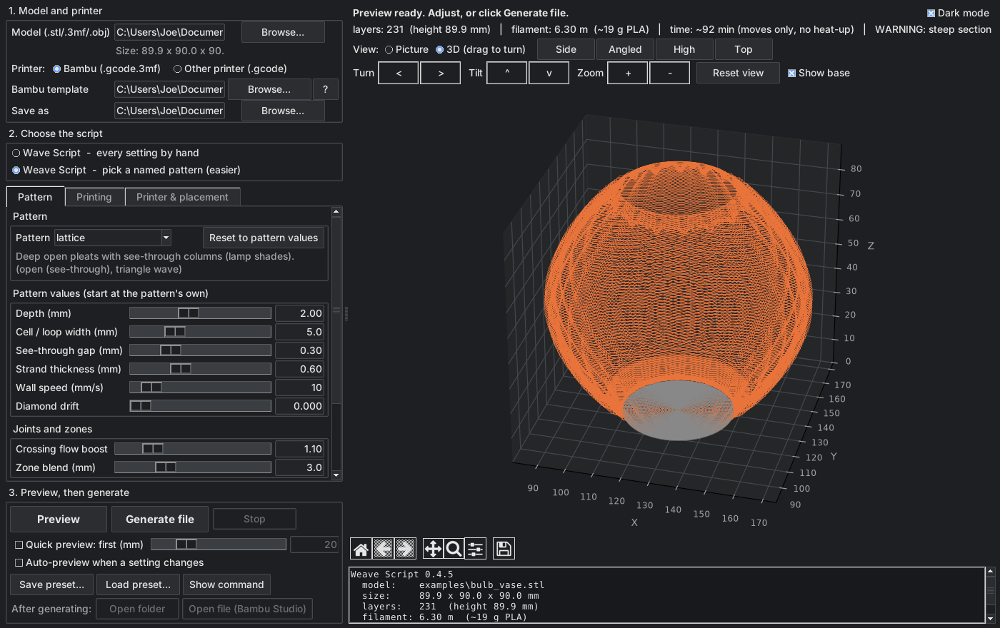

# Wave Studio

Wave Studio is a window with sliders for Wave Script and Weave Script. You don't type any
commands: pick a model, move the sliders, click **Preview** to see the toolpath, then click
**Generate file** to make the print.

## Installing (one time, no command line needed)

**Windows:**

1. **Install Python** 3.10 or newer from [python.org](https://www.python.org/downloads/).
   On the first screen of the installer, tick **"Add python.exe to PATH"**. Leave the other
   options as they are (Wave Studio needs "tcl/tk", which is on by default).
2. **Download Wave Script:** on the [GitHub page](https://github.com/ObjetekSystems/wave-script)
   click the green **Code** button, then **Download ZIP**. Unzip it somewhere easy to find,
   for example `Documents\Wave Script`.
3. In that folder, double-click **`Install Wave Studio.bat`**. It checks Python, installs the
   libraries the scripts need, and checks the window toolkit. It takes a few minutes and ends
   with **"All set"**.

**Mac / Linux:** in a terminal in the Wave Script folder run
`python3 -m pip install -r requirements.txt`. On Linux you may also need the window toolkit,
for example `sudo apt install python3-tk`.

## Starting it

**Windows:** double-click **`Wave Studio.bat`** in the Wave Script folder.

**Mac / Linux:** `python3 wave_studio.py`

If a library is missing, Wave Studio tells you what to run.

## Making a print in 3 steps

**1. Model and printer**
- **Model:** click **Browse...** and pick your `.stl`, `.3mf` or `.obj`. The size is shown underneath.
- **Printer:** choose **Bambu** (writes a `.gcode.3mf` you open in Bambu Studio) or **Other
  printer** (writes plain `.gcode`).
- **Bambu template:** Bambu printers need a template once per model. Click **?** for the steps,
  or see [Making a Bambu template](BAMBU_TEMPLATE.md).
- **Save as:** filled in for you next to the model. Change it if you like.

**2. Choose the script**
- **Weave Script:** pick a pattern (lattice, chainmail, basket, scales...). The sliders jump to
  that pattern's own values, and you can fine-tune them from there. **Reset to pattern values**
  undoes your changes. Tick **Solid band at the bottom/top** for a plain base or rim.
- **Wave Script:** set every value yourself: amplitude, wavelength, phase shift, stagger,
  open weave and more. **Reset to defaults** puts them all back. Tick **Solid band at the bottom**
  for a plain smooth wall before the wave starts (the flat floor is *Solid base layers* on the
  Printing tab).

Rest the mouse on any setting to see what it does. Settings with a tick box are optional:
leave them unticked and the script uses its own value.

**3. Preview, then generate**
- **Preview** shows the toolpath, a close-up of the wall and the strands to scale.
  **Quick preview** (on by default) only builds the bottom 20 mm, so it's done in a few seconds.
  Untick it to preview the whole height.
- **View: Picture / 3D.** *Picture* shows the script's preview image. *3D* shows the real
  toolpath that you can turn like in CAD: drag with the left mouse button to rotate and tilt,
  use the mouse wheel (or **+ / -**) to zoom, and click **Side / Angled / High / Top** to jump
  to a view. **High** and **Top** look down into the part. **Show base** adds the bottom layers.
  **No mouse?** Use the **Turn < >**, **Tilt ^ v** and **Zoom + -** buttons (hold them down to
  keep moving), or the keyboard: arrow keys turn and tilt, **+ / -** zoom, **Home** resets.
  A two-finger scroll on a trackpad also zooms.
- **Auto-preview** updates the preview by itself a moment after you change a setting.
- The line above the picture shows layers, filament, print time and any warnings (for example
  steep sections that may sag).
- **Generate file** writes the full print. Then **Open file** opens it (a `.gcode.3mf` opens in
  Bambu Studio) and **Open folder** shows where it went.

## Presets and the command line

- **Save preset... / Load preset...** store every setting in a small `.json` file, so you can
  keep favorites like "chainmail lamp shade" and share them.
- **Dark mode:** tick the box at the top right. The preview pictures switch to dark too.
- Wave Studio remembers your last settings when you close it.
- **Show command** copies the matching command line to the clipboard. Wave Studio only runs
  `wave_script.py` and `weave_script.py` for you, so anything you make in the window can be
  repeated from the command line exactly.
