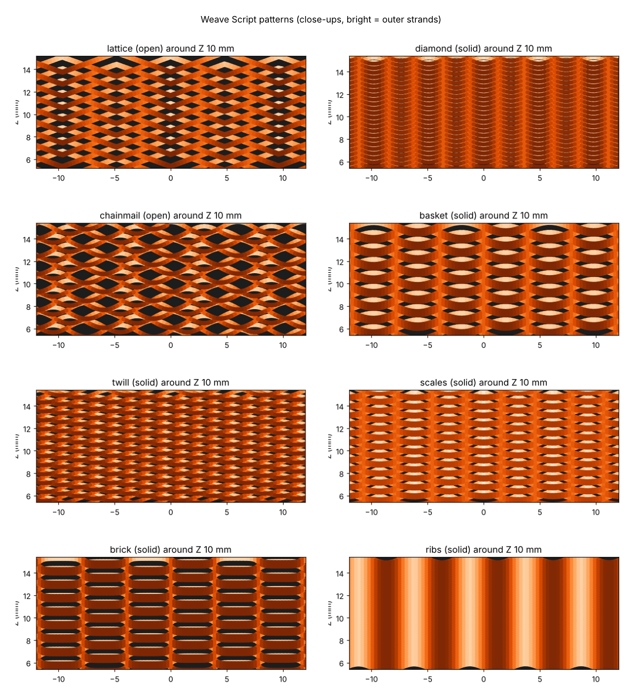
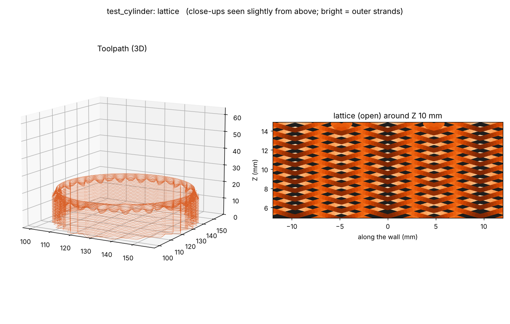
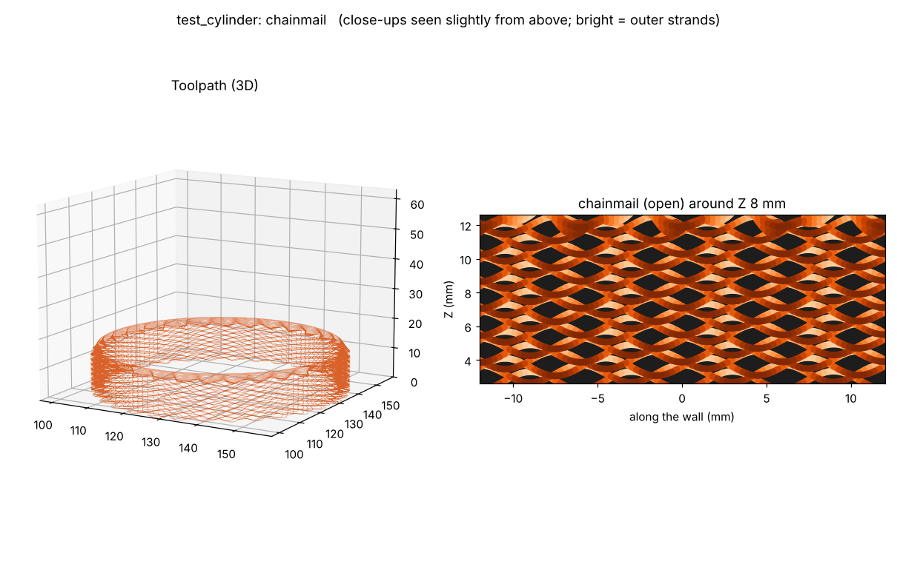
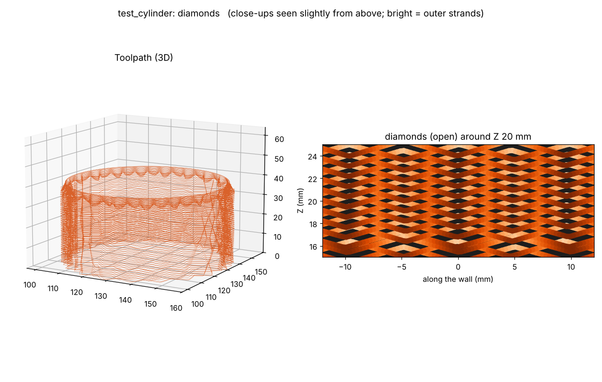

# Weave Script guide

`weave_script.py` is the easy companion to Wave Script. Instead of tuning amplitude,
wavelength, phase shift and gap by hand, you **pick a pattern by name**, and optionally split
the part into **height zones** with a different pattern in each.

It uses the same slicing, Bambu template and G-code output as `wave_script.py`, so keep both
files in the same folder. For Bambu printers, see [Making a Bambu template](BAMBU_TEMPLATE.md). Install is the same (see the main README).



> **New to typing commands?** Read [Command line basics](COMMAND_LINE_BASICS.md) first. It
> shows how to open the Command Prompt in the right folder, what each part of a command means,
> and how to use your own model. After that, you can copy and paste the examples below.

## Quick start

See all the patterns:

```
python weave_script.py --list
```

Make a short 15 mm lattice test on the included cylinder, for a Bambu printer:

```
python weave_script.py examples/test_cylinder.stl --pattern lattice --max-height 15 --bambu-template examples/template.gcode.3mf
```

This writes `examples/test_cylinder_weave.gcode.3mf` (open it in Bambu Studio and print) and
`examples/test_cylinder_weave_preview.png` (check it first).

**For other printers** (Prusa, Creality, Klipper...), leave off everything from
`--bambu-template` onward. You'll get a plain `.gcode` file instead.

## Patterns

| Pattern | Wall | Look | Defaults |
|---|---|---|---|
| `lattice` | open | Deep open pleats with see-through columns. Great for lamp shades and translucent filament. Print-tested with a clean rim (Wave Script guide, test 15L5). | depth 2, cell 5, gap 0.3, strand 0.6, 10 mm/s, triangle wave, valley 2.25 |
| `diamonds` | open | **Experimental.** Big diamond shapes: alternate laps drift opposite ways around the ring (`drift`), so the crossings line up in criss-crossing diagonals. With `drift=0.02` (default) each lap still sits over the lap two below, like lattice, but the diamonds are about 25 mm tall and soft. `drift=0.05` gives bolder diamonds of about 10 mm, but laps no longer sit over the lap two below, so they may sag. Soft version print-tested: the rim holds and the diamond shading shows, but loops can deform on one side of the part (Wave Script guide, tests 17s–17L). Still being worked on. | lattice settings + drift 0.02 |
| `diamond` | solid | Classic tight weave (Wave Script's default look). | depth 1.0, cell 2.5 |
| `chainmail` | open | Rings where each row tucks between the loops below. Print-tested with a clean rim (Wave Script guide, test 18b). | depth 1.5, cell 3, gap 0.3, stagger 2, valley 0.9 |
| `basket` | solid | Over-under bands three strands tall. | depth 1.5, cell 4, group 3 |
| `twill` | solid | Fine diagonal woven lines. | depth 1.0, cell 3, shift 0.25 |
| `scales` | solid | Overlapping rounded scales. | depth 1.2, cell 3, scallop wave, group 2 |
| `brick` | solid | Rectangular blocks offset like brickwork. | depth 1.0, cell 4, square wave, group 3 |
| `ribs` | solid | Straight vertical ribs. Always prints. | depth 1.0, cell 2.5, shift 0 |
| `solid` | solid | Plain smooth wall, for bases, caps and rims in zones. | no wave |

**Open** patterns are see-through: strands only touch where they cross. **Solid** patterns
are packed into a closed, textured wall.

### Example previews

Every run also writes a `_preview.png` next to the output. These are the previews for the
print-tested open patterns on the included test cylinder, so you can compare your own preview
with them. The left panel is the whole toolpath; the right panel is a close-up of the wall,
seen slightly from above (bright = outer strands, dark gaps = see-through openings).

**Lattice** (20 mm band):

```
python weave_script.py examples/test_cylinder.stl --pattern lattice --base-layers 0 --max-height 20
```



**Chainmail** (15 mm band):

```
python weave_script.py examples/test_cylinder.stl --pattern chainmail --base-layers 0 --max-height 15
```



**Diamonds, soft** (40 mm band, experimental). The diamond shading builds up over the height
of the part, so it shows best on taller prints:

```
python weave_script.py examples/test_cylinder.stl --pattern diamonds --base-layers 0 --max-height 40
```



Add `--bambu-template examples/template.gcode.3mf` to any of these to print on a Bambu printer.
Your preview should look the same; if you change `--depth`, `--cell` or `--gap`, compare with
these to see what changed.

## Example commands (copy and paste)

Every example below uses the included test cylinder and a Bambu template called
`examples/template.gcode.3mf`. Make that template first: slice `examples/test_cylinder.stl` in
Bambu Studio and export it, as described in [Making a Bambu template](BAMBU_TEMPLATE.md). Then
you can copy and paste the examples as they are. To use **your own model**:

1. Replace `examples/test_cylinder.stl` with your STL (drag it into the window).
2. Replace `examples/template.gcode.3mf` with a template you sliced from **that same STL** in
   Bambu Studio.

> **Tip:** add `--max-height 15` to any command to print just the bottom 15 mm as a quick,
> cheap test. Remove it for the full print.

### One pattern for the whole part

**Lattice** (deep open pleats with see-through columns):
```
python weave_script.py examples/test_cylinder.stl --pattern lattice --bambu-template examples/template.gcode.3mf
```

**Diamond** (classic tight weave, solid wall):
```
python weave_script.py examples/test_cylinder.stl --pattern diamond --bambu-template examples/template.gcode.3mf
```

**Chainmail** (open rings):
```
python weave_script.py examples/test_cylinder.stl --pattern chainmail --bambu-template examples/template.gcode.3mf
```

**Basket:**
```
python weave_script.py examples/test_cylinder.stl --pattern basket --bambu-template examples/template.gcode.3mf
```

**Twill** (diagonal lines):
```
python weave_script.py examples/test_cylinder.stl --pattern twill --bambu-template examples/template.gcode.3mf
```

**Scales:**
```
python weave_script.py examples/test_cylinder.stl --pattern scales --bambu-template examples/template.gcode.3mf
```

**Brick:**
```
python weave_script.py examples/test_cylinder.stl --pattern brick --bambu-template examples/template.gcode.3mf
```

**Ribs** (safest first print, no bridging):
```
python weave_script.py examples/test_cylinder.stl --pattern ribs --bambu-template examples/template.gcode.3mf
```

### Making a pattern bigger, smaller, deeper or more open

**Bigger loops** (`--cell` is the width of one loop in mm):
```
python weave_script.py examples/test_cylinder.stl --pattern lattice --cell 7 --bambu-template examples/template.gcode.3mf
```

**Smaller, finer loops:**
```
python weave_script.py examples/test_cylinder.stl --pattern basket --cell 2.5 --bambu-template examples/template.gcode.3mf
```

**Deeper texture** (`--depth` is how far the strands move in and out, in mm):
```
python weave_script.py examples/test_cylinder.stl --pattern scales --depth 2 --bambu-template examples/template.gcode.3mf
```

**Gentler, shallower texture:**
```
python weave_script.py examples/test_cylinder.stl --pattern lattice --depth 1.5 --bambu-template examples/template.gcode.3mf
```

**Turn a solid pattern into a see-through one** (`--gap` in mm; keep it at or below the strand size):
```
python weave_script.py examples/test_cylinder.stl --pattern basket --gap 0.3 --strand 0.5 --bambu-template examples/template.gcode.3mf
```

**Turn the open lattice into a solid wall:**
```
python weave_script.py examples/test_cylinder.stl --pattern lattice --gap 0 --bambu-template examples/template.gcode.3mf
```

**Chunkier strands:**
```
python weave_script.py examples/test_cylinder.stl --pattern chainmail --strand 0.7 --gap 0.4 --bambu-template examples/template.gcode.3mf
```

### Lamp shades and open-bottom parts

**Lattice with no bottom** (`--base-layers 0`):
```
python weave_script.py examples/test_cylinder.stl --pattern lattice --base-layers 0 --bambu-template examples/template.gcode.3mf
```

**No bottom and a thicker top rim** (`--top-layers 4`):
```
python weave_script.py examples/test_cylinder.stl --pattern chainmail --base-layers 0 --top-layers 4 --bambu-template examples/template.gcode.3mf
```

### Zones: different patterns at different heights

Zones go in quotes after `--zones`. Each zone is `start-end:pattern`, separated by commas.
Heights are in mm from the bed, or `%` of the model's height. Leave the end blank to mean
"to the top".

**Solid base, lattice middle, solid top** (a lamp shade):
```
python weave_script.py examples/test_cylinder.stl --zones "0-10:solid, 10-50:lattice, 50-:solid" --bambu-template examples/template.gcode.3mf
```

**The same idea using percentages** (works on any size model):
```
python weave_script.py examples/test_cylinder.stl --zones "0-15%:solid, 15%-85%:lattice, 85%-:solid" --bambu-template examples/template.gcode.3mf
```

**Three textures stacked:**
```
python weave_script.py examples/test_cylinder.stl --zones "0-20:ribs, 20-40:basket, 40-:scales" --bambu-template examples/template.gcode.3mf
```

**Bands of open and solid:**
```
python weave_script.py examples/test_cylinder.stl --zones "0-15:diamond, 15-30:chainmail, 30-45:diamond, 45-:chainmail" --bambu-template examples/template.gcode.3mf
```

**Give one zone its own settings** (add `@` and the settings after the pattern name):
```
python weave_script.py examples/test_cylinder.stl --zones "0-10:solid, 10-50:lattice@depth=2,cell=6, 50-:solid" --bambu-template examples/template.gcode.3mf
```

**A sharp switch between zones instead of a fade** (`--blend 0`):
```
python weave_script.py examples/test_cylinder.stl --zones "0-30:ribs, 30-:basket" --blend 0 --bambu-template examples/template.gcode.3mf
```

### Open patterns and the top rim (from the test prints)

**Lattice, 20 mm test band** (tested: clean rim):
```
python weave_script.py examples/test_cylinder.stl --pattern lattice --base-layers 0 --max-height 20 --bambu-template examples/template.gcode.3mf -o examples/test_cylinder_lattice.gcode.3mf
```

**Any open pattern with no rim, to measure the dip at the top edge** (here chainmail):
```
python weave_script.py examples/test_cylinder.stl --pattern chainmail --top-layers 0 --base-layers 0 --max-height 15 --bambu-template examples/template.gcode.3mf -o examples/test_cylinder_chainmail_norim.gcode.3mf
```

**Use the measured dip for the rim** (replace 1.5 with your measurement):
```
python weave_script.py examples/test_cylinder.stl --pattern chainmail --valley-depth 1.5 --base-layers 0 --max-height 15 --bambu-template examples/template.gcode.3mf -o examples/test_cylinder_chainmail_valley.gcode.3mf
```

**Gentler dips into the valleys** (if the nozzle touches the peaks):
```
python weave_script.py examples/test_cylinder.stl --pattern lattice --valley-slope 1.0 --base-layers 0 --max-height 20 --bambu-template examples/template.gcode.3mf -o examples/test_cylinder_lattice_gentle.gcode.3mf
```

**Chainmail set up like Wave Script's test 15** (the control print that held):
```
python weave_script.py examples/test_cylinder.stl --zones "0-:chainmail@group=2,stagger=4,cell=2.5" --speed 12 --top-layers 2 --node-flow 1.0 --valley-depth 0 --base-layers 0 --max-height 15 --bambu-template examples/template.gcode.3mf -o examples/test_cylinder_weave_control.gcode.3mf
```

**Big diamonds, soft** (experimental):
```
python weave_script.py examples/test_cylinder.stl --pattern diamonds --base-layers 0 --max-height 40 --bambu-template examples/template.gcode.3mf -o examples/test_cylinder_diamonds_soft.gcode.3mf
```

**Big diamonds, bold** (experimental, may sag):
```
python weave_script.py examples/test_cylinder.stl --pattern diamonds --drift 0.05 --base-layers 0 --max-height 40 --bambu-template examples/template.gcode.3mf -o examples/test_cylinder_diamonds_bold.gcode.3mf
```

### Fixing print problems

**Strands sag between crossings:** slow down and make the loops smaller.
```
python weave_script.py examples/test_cylinder.stl --pattern lattice --speed 12 --cell 4 --bambu-template examples/template.gcode.3mf
```

**Crossings break apart:** more flow at the joints and a smaller gap.
```
python weave_script.py examples/test_cylinder.stl --pattern lattice --node-flow 1.2 --gap 0.35 --bambu-template examples/template.gcode.3mf
```

**Strands look thin or stringy:** more flow overall.
```
python weave_script.py examples/test_cylinder.stl --pattern chainmail --flow 1.05 --bambu-template examples/template.gcode.3mf
```

### Other useful options

**Print the model upside down** (rotating it in Bambu Studio doesn't carry over):
```
python weave_script.py examples/test_cylinder.stl --pattern basket --flip --bambu-template examples/template.gcode.3mf
```

**Choose the output file name:**
```
python weave_script.py examples/test_cylinder.stl --pattern brick -o my_brick_cup.gcode.3mf --bambu-template examples/template.gcode.3mf
```

**Skip the preview picture** (a bit faster):
```
python weave_script.py examples/test_cylinder.stl --pattern twill --no-preview --bambu-template examples/template.gcode.3mf
```

**Other printers** (plain `.gcode`; set your temperatures and bed size):
```
python weave_script.py examples/test_cylinder.stl --pattern lattice --nozzle-temp 215 --bed-temp 60 --bed-size 220 220
```

**The included bulb vase, with zones:** make a Bambu template from `examples/bulb_vase.stl`
first and save it as `examples/template_bulb.gcode.3mf`.
```
python weave_script.py examples/bulb_vase.stl --zones "0-12:solid, 12-60%:lattice, 60%-:solid" --bambu-template examples/template_bulb.gcode.3mf
```

## Zones

Zones give a part different patterns at different heights, for example a lamp shade with a
solid base, lattice middle and solid cap.

```
python weave_script.py lamp.stl --zones "0-15:solid, 15-70:lattice, 70-:solid"
```

- Heights are **mm from the bed**, or **% of the model height** (`"0-20%:solid, 20%-:basket"`).
- Leave the end blank to mean "to the top" (`70-:solid`).
- Any height not covered by a zone uses `--pattern`.
- Where two zones meet, the wave fades out and back in over `--blend` mm (default 3), so the
  pattern changes at a smooth wall instead of with a jump.

Change a setting for one zone only with `@`:

```
--zones "0-12:solid, 12-60:lattice@depth=2,cell=6, 60-:basket@depth=1"
```

Zone settings: `depth`, `cell`, `gap`, `strand`, `speed`, `group`, `stagger`, `shift`.

## Settings

| Setting | Default | What it does |
|---|---|---|
| `--pattern` | lattice | The pattern for the whole part (or for heights outside your zones). |
| `--zones` | none | Height bands with their own pattern (see above). |
| `--blend` | 3 mm | Fade distance where zones meet. 0 = hard switch. |
| `--depth` | from pattern | mm the strands move in and out (all patterned zones). |
| `--cell` | from pattern | mm width of one loop or opening. Rounded so whole cells fit around the part. |
| `--gap` | from pattern | mm of see-through gap. 0 = solid wall. Can't be bigger than the strand. |
| `--strand` | from pattern | mm strand thickness for open patterns. |
| `--drift` | from pattern | Diamonds: how far alternate laps drift apart per lap (waves). 0.02 = soft, about 25 mm diamonds; 0.05 = bold, about 10 mm. |
| `--seam-angle` | 0 | Where each lap starts, in degrees: 0 = right (+X), 90 = back, 180 = left, 270 = front. Useful for telling a toolpath problem from a printer-side one (cooling). |
| `--node-flow` | 1.1 | Open patterns: extra extrusion right where strands cross, so the joints fuse. 1.0 = off. |
| `--speed` | from pattern | Wall speed. Open patterns also slow down further between crossings. |
| `--base-layers` | 3 | Solid bottom layers. 0 = open bottom (lamp shades). |
| `--top-layers` | 2 | Solid rim laps on top so the weave can't unravel. More laps make a stiffer ring that pulls harder on the weave as it cools. See "How the top rim works" below. |
| `--valley-depth` | 0 (off) | Open patterns: how deep the top edge dips between crossings (mm), measured on a test print with `--top-layers 0`. The closing laps start down in each dip and level the top before the rim. Default: the pattern's measured value (lattice 2.25 mm, chainmail 0.9 mm; others 0 until measured). |
| `--valley-slope` | 1.3 | Steepest dip into a valley (rise over run). 1.0 = 45°, 1.3 = about 52°. Lower it if the nozzle touches the peaks. |
| `--densify-height` | 2 mm | Open patterns: height just below the rim where the gaps close into a dense band. 0 = off. |
| `--layer-height` / `--line-width` | 0.2 / 0.5 | For solid patterns and the base. |
| `--max-height` | full | Stop early for test prints. |
| `--bambu-template`, `--bed-size`, `--center`, `--flip`, `-o`, `--no-preview` | | Same as Wave Script. |

## How the open patterns hold together

- Each lap is shifted half a wave from the one below, so neighbouring laps cross every half
  wave. Each lap rises `(strand + gap) / 2`, so strands two laps apart have a see-through gap.
- The script finds the crossings from the actual path (points within half a strand of the
  lap below). It adds `--node-flow` there so the joints fuse, and slows to the pattern's bridge
  speed everywhere else.
- Use full cooling and translucent PETG or PLA for the glowing look. Start with
  `--max-height 15` to check the joints before committing to a full print.

## How the top rim works

Since 0.2.0, Weave Script uses the same rim as Wave Script 0.6.6, which printed cleanly in
Wave Script's test 15.

- **Open patterns** (lattice, chainmail): over the last `--densify-height` mm (2 by default)
  the gap closes and the strands blend into flat lines, with the wave left unchanged. Then come
  a few closing laps that repeat the lap below and shrink the wave 0.15 mm per lap, so every lap
  sits right on top of the one beneath. The solid rim laps go last.
- **Patterns that cross on every lap** (lattice, chainmail) switch to stacked pairs in that band
  (one lap stacks on the lap below, the next crosses) and the stagger stops. Without that, the
  chainmail rim peeled off in one piece (0.2.0 and 0.2.1). The band and rim print at no more
  than 12 mm/s, and the rim is 2 laps by default (0.2.2).
- **Deep open patterns** (0.3.0): the strands sag between crossings, so the top edge is a row of
  peaks and valleys, and a flat rim only touches the peaks. Print a short band with
  `--top-layers 0`, measure the dip from a peak to the valley next to it, and pass it as
  `--valley-depth`. The closing laps then start down in each valley, on the sagged strand, and
  rise a little faster there than at the peaks until the top is level. The dips are kept no
  steeper than `--valley-slope` (default 1.3, about 52°) so the nozzle clears the peaks; where
  that stops the first lap short of the bottom, it pushes out extra plastic. The closing and
  rim laps are as wide as the strands, and at least 0.6 mm wide at no more than 10 mm/s (0.4.3:
  chainmail's thinner, faster band came loose on one side), so the band bonds and matches the body. The densify
  band is skipped when `--valley-depth` is set.
- **Solid patterns** fade the wave out over `--blend` mm just below the rim, as before.
- Earlier versions faded the wave out while open strands were still crossing. Wave Script's
  tests 13 and 14 showed that the rim then has nothing to grip, and it pulls loose into
  strings.

## Tips

- If open strands sag, lower `--depth` or `--cell`, or slow down with `--speed`.
- If crossings break apart, raise `--node-flow` to 1.15–1.2, or lower `--gap`.
- Steep sections are reported with their height. Solid patterns handle them better than open
  ones. For really steep solid walls use `wave_script.py --adaptive`.
- Want something the presets don't do? Every pattern maps to Wave Script settings, so you can
  fine-tune it there: `--amplitude` = depth, `--wavelength` = 2 × cell, `--weave-gap` = gap,
  `--weave-height` = group, plus `--stagger` and `--phase-shift`.

The pattern picture at the top of this guide is made by `docs/make_weave_images.py`. You only
need it if you change the patterns and want to redraw it (see "Documentation image scripts" in
the [full guide](GUIDE.md)).
